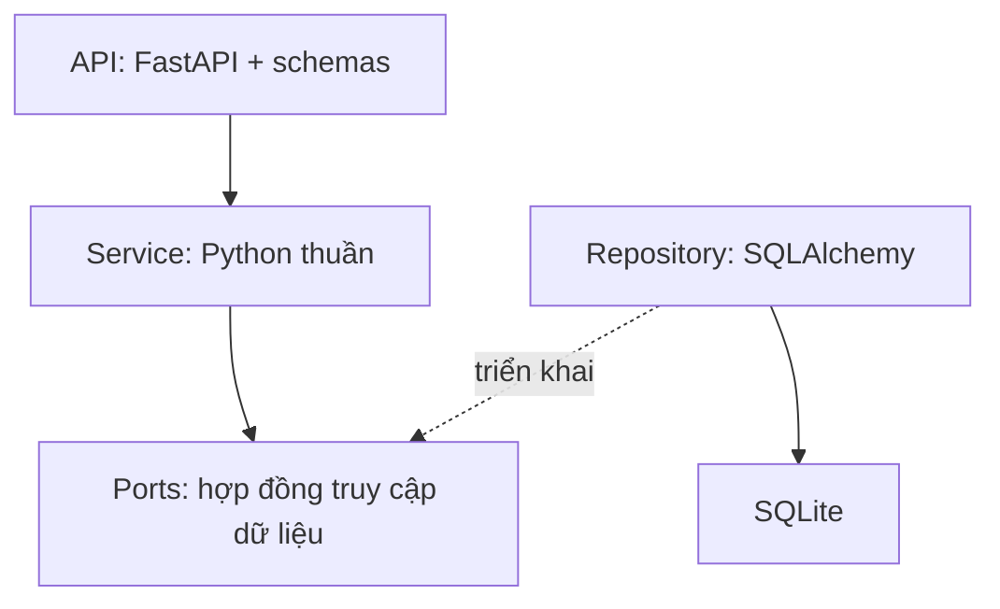

# MatchMate Backend

Skeleton tối thiểu cho backend tìm kèo và ghép người chơi cầu lông, Pha 1 môn Kiến trúc phần mềm.

**Trạng thái: chỉ triển khai nền tảng kỹ thuật.** `GET /health` hoạt động; chưa có auth, database hoặc logic nghiệp vụ. 11 API nghiệp vụ là phạm vi dự kiến, chưa xuất hiện trong Swagger. Không có endpoint giả trả `501`, dữ liệu nghiệp vụ mẫu hoặc service/repository chứa TODO.

## Chạy local

Yêu cầu Python 3.11+ và Git. Docker/CI dùng Python 3.11. Các lệnh dưới đây dành cho macOS/Linux, chạy từ thư mục gốc repository.

```bash
git clone https://github.com/datdooo/matchmate-backend.git
cd matchmate-backend
python3 -m venv .venv
source .venv/bin/activate
python -m pip install -r requirements-dev.txt
python -m uvicorn app.main:app --reload --no-access-log
```

| Đường dẫn local | Mục đích |
| --- | --- |
| http://127.0.0.1:8000/health | Liveness, trả `{"status":"ok"}`; không kiểm DB |
| http://127.0.0.1:8000/docs | Swagger UI, hiện chỉ có health |
| http://127.0.0.1:8000/redoc | ReDoc |
| http://127.0.0.1:8000/openapi.json | Schema OpenAPI |

`.env.example` chỉ ghi biến mục tiêu cho bước auth/DB sau này. Skeleton không đọc chúng và không cần tạo `.env` để chạy. Secret thật không được commit.

## Docker

```bash
docker compose up --build -d
docker compose ps
curl http://127.0.0.1:8000/health
docker compose down
```

Container dùng một Uvicorn worker và user non-root. Volume `/app/data` chuẩn bị cho SQLite ở bước sau; skeleton chưa tạo DB hoặc seed. `docker compose down` giữ volume; thêm `-v` sẽ xóa volume cùng dữ liệu nếu sau này đã có DB.

## Kiểm tra

```bash
python -m ruff check .
python -m ruff format --check .
python -m pytest -q
```

Test đồng bộ dùng FastAPI `TestClient` và HTTPX, không cần `pytest-asyncio`. Kiểm health, giao diện tài liệu và schema chỉ có health. CI hiện chạy lint/format/test, chưa build hoặc publish Docker image và chưa thiết lập branch protection.

`requirements*.txt` chọn dependency cần cài; `constraints.txt` pin các phiên bản. Khi thêm thư viện, cập nhật constraints sau kiểm tra, không sao chép `pip freeze` từ môi trường cá nhân có các package không liên quan.

## Cấu trúc và kiến trúc mục tiêu

| Đường dẫn hiện có | Vai trò |
| --- | --- |
| `app/main.py` | FastAPI và health; chưa include router nghiệp vụ |
| `app/features/auth/` | Package đặt chỗ cho Chiến |
| `app/features/discovery/` | Package đặt chỗ cho Hải |
| `app/features/sessions/` | Package đặt chỗ; phân chia file theo bảng dưới |
| `tests/test_foundation.py` | Smoke test nền tảng |

Chỉ giữ ba package feature để chia việc. `app/api/`, `app/domain/`, `app/db/` và các file schema/service/contracts/repository sẽ được tạo khi triển khai, không tạo sẵn package dùng chung trống hoặc sub-package sessions.

Kiến trúc mục tiêu là API → Service → Repository/ORM. Service dùng entity/DTO và port Python thuần; không import framework web hoặc thư viện DB. Repository map dữ liệu ORM; composition root nối các thành phần. Đây là thiết kế mục tiêu, chưa phải code đã có trong skeleton.



Đặc tả và nghiệm thu: [Google Docs MatchMate](https://docs.google.com/document/d/1uKPAGgImttE029ZZ9ZAqeioh0bX514sAla_Jq38PPj4/edit?tab=t.0).

## Phân công và ownership

| Người | Phạm vi sau skeleton | Nhánh |
| --- | --- | --- |
| Chiến | Auth; tạo/xem/hủy kèo; 5 API; tích hợp | `feature/auth-session-management` |
| Hải | Tra cứu/GPS/matching; 3 API | `feature/discovery-matching` |
| Đạt | Xin/duyệt/rút lượt; 3 API; DB/UoW và tải | `feature/participations-transactions` |

Trong `sessions/`, Chiến tạo/sở hữu `session_*.py`; Đạt tạo/sở hữu `participation_*.py`. Các port dùng chung và router tổng hợp được thống nhất bằng PR nhỏ trước khi tích hợp; không gọi chéo Service.

Chiến tích hợp `app/main.py`, dependency/constraints, `pyproject.toml`, Docker/Compose, CI và README. Đạt sở hữu hạ tầng DB/UoW khi được tạo. Thành viên có thể đề xuất patch file chung trong PR; người tích hợp review và phối hợp, không cấm đóng góp. Không có router auto-discovery.

## Git workflow

`main` là baseline tích hợp; chưa dùng `develop`. Ba feature branch tách từ cùng commit skeleton. Sau mỗi thay đổi chung đã merge, đồng bộ `main` trước khi tiếp tục:

```bash
git fetch origin
git switch feature/discovery-matching
git merge origin/main
```

Mỗi người làm trên nhánh được giao và mở PR vào `main`; ít nhất một người khác tác giả review. Commit theo thay đổi thực tế: `feat:`, `fix:`, `docs:`, `test:`, `chore:`. Branch protection là việc cấu hình sau, chưa được bật chỉ vì có CI.

## Phạm vi baseline và bước tiếp theo

Skeleton không có entity/enum nghiệp vụ, Protocol, ORM, connection DB, JWT/hash, UoW, repository, Haversine, matching, seed hoặc runner tải. Không tạo frontend, issue/project board hay workflow deploy.

Sau baseline mới triển khai auth và luồng tạo → xin → duyệt trên SQLite thật. Mốc mục tiêu cuối tuần 1 là luồng này chạy cùng Docker, auth và protected GET/POST. Swagger là demo chính; UI đầy đủ và tải bổ sung làm sau.

Nguồn kỹ thuật: [FastAPI testing](https://fastapi.tiangolo.com/tutorial/testing/), [pip constraints](https://pip.pypa.io/en/stable/topics/dependency-resolution/), [GitHub Python CI](https://docs.github.com/actions/guides/building-and-testing-python).
