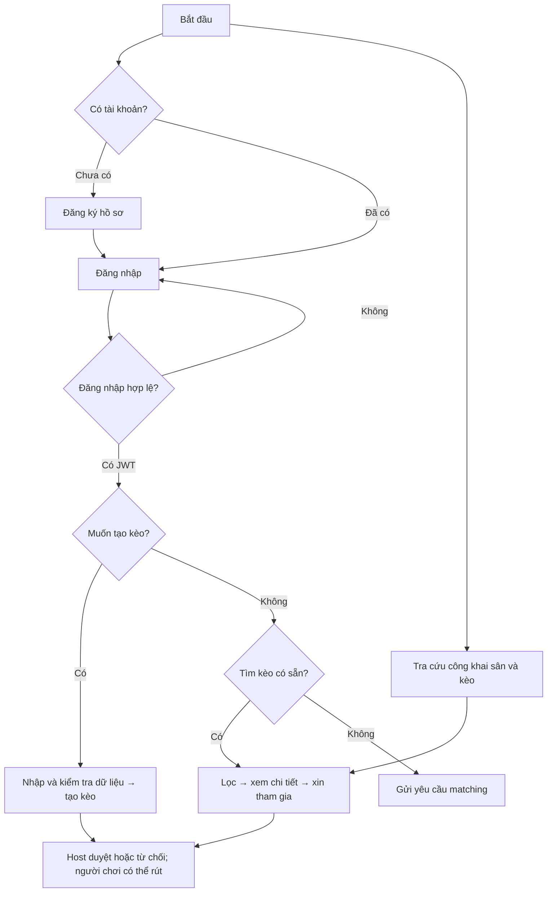
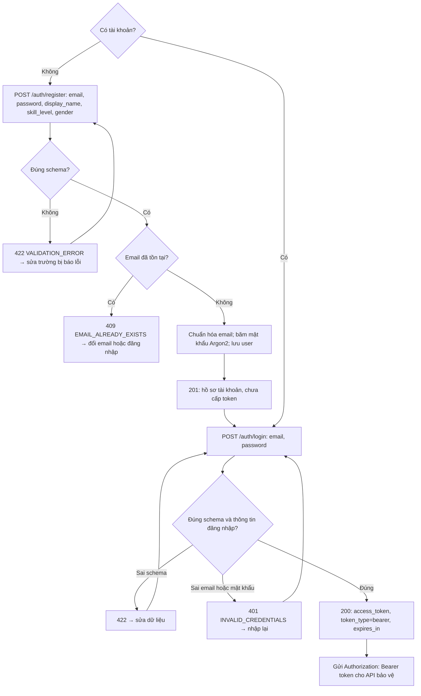
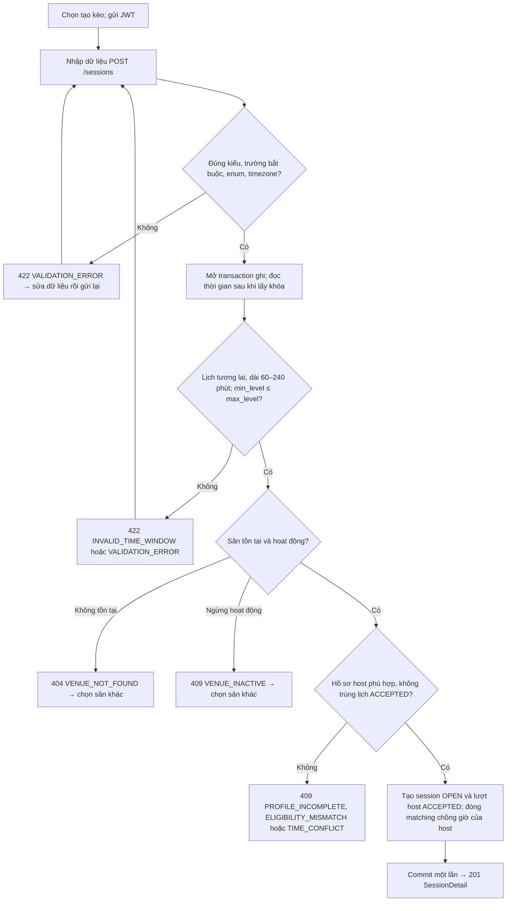
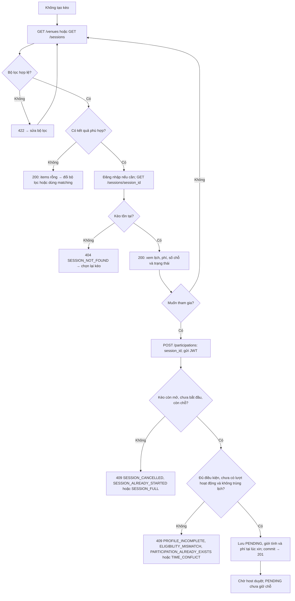
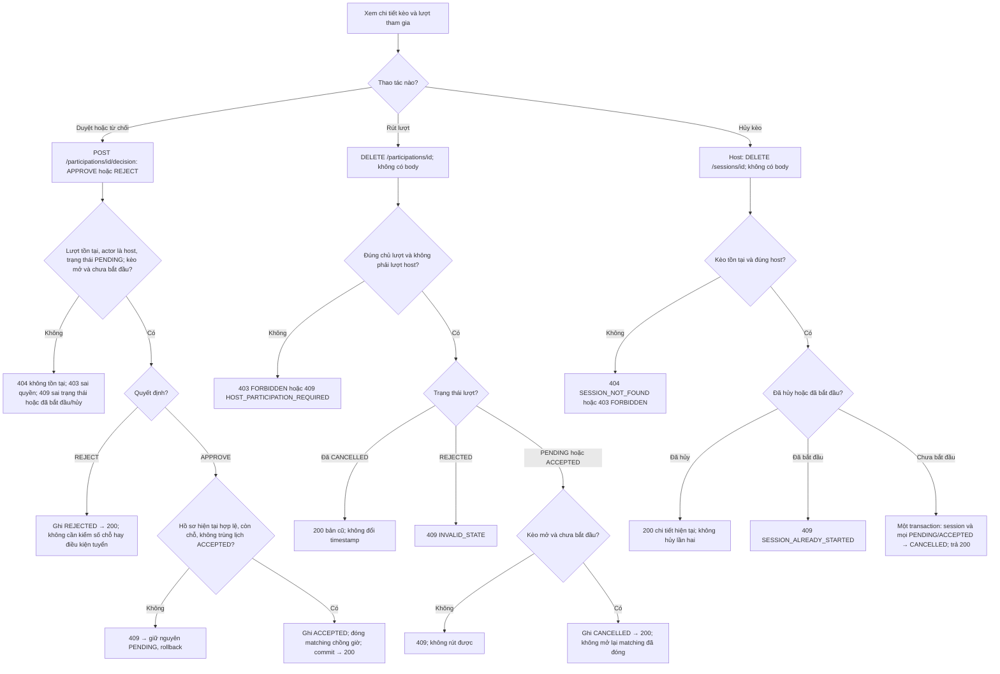
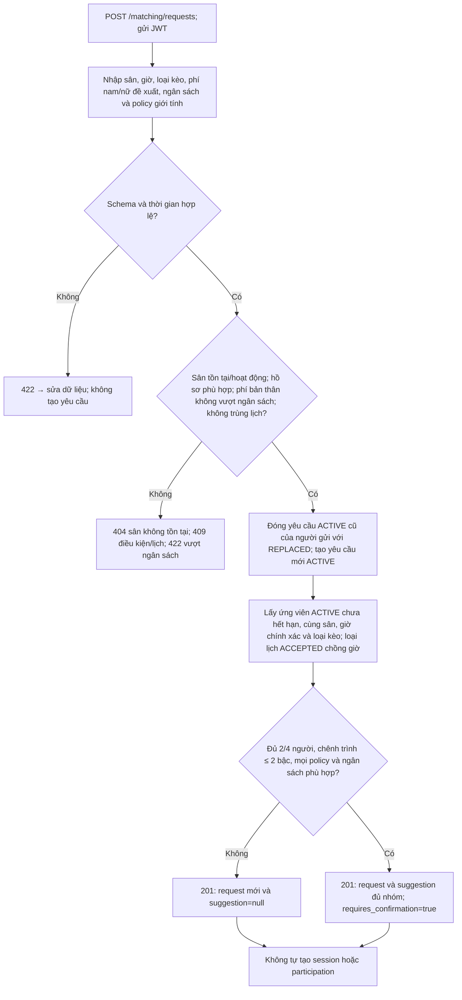
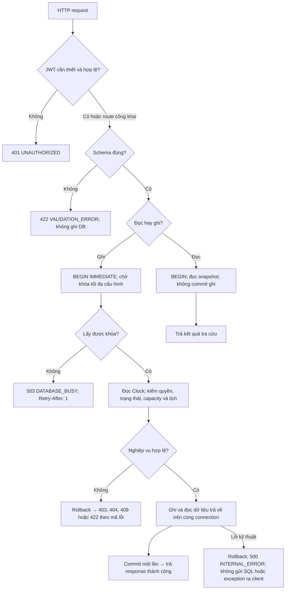

# MatchMate Backend

MatchMate giúp người chơi cầu lông tìm kèo và giúp chủ kèo tuyển thêm người. Bản Pha 1 là backend REST JSON, có thể gọi thử API bằng Swagger UI. Sân và kèo được tìm theo quận (`district_code`), không dùng GPS.

Backend có 11 API nghiệp vụ, 5 bảng dữ liệu và 19 mức trình. Các chức năng gồm quản lý hồ sơ, tìm sân, tạo kèo, xử lý lượt tham gia và gợi ý ghép nhóm. Endpoint `/health` dùng để kiểm tra tiến trình còn chạy.

## Bài toán và nghiệp vụ

Người chơi cần biết kèo nào còn chỗ, có phù hợp với mình và có trùng lịch đã nhận hay không. Khi chủ kèo duyệt người tham gia, hệ thống phải kiểm tra lại các điều kiện đó để tránh nhận quá số người.

Một tài khoản đã đăng ký có thể tìm hoặc tạo kèo. Người tạo kèo được gọi là host và có quyền quản lý các yêu cầu tham gia kèo đó. Host không phải vai trò quản trị riêng của hệ thống.

- Người chơi có thể đăng ký hồ sơ, đăng nhập và tìm sân, tìm kèo theo quận, trình độ, giới tính, lịch và phí.
- Khi tạo kèo, host chọn sân, loại đơn hoặc đôi và một lịch cố định ở tương lai, dài 60–240 phút. Kèo đơn có 2 người, kèo đôi có 4 người, tính cả host. Host tự có một lượt `ACCEPTED`; người xin tham gia được lưu ở trạng thái `PENDING` và chưa giữ chỗ. Host duyệt hoặc từ chối trước giờ bắt đầu.
- Khi duyệt, hệ thống kiểm lại điều kiện tham gia, số chỗ và lịch `ACCEPTED` hiện tại. Hai lịch nối tiếp được phép. Phí và giới tính được giữ theo thời điểm xin tham gia; nếu đăng ký lại thì tạo lượt mới. Người chơi được rút lượt của mình, còn host phải hủy cả kèo.
- Matching tìm nhóm đủ 2/4 người có cùng sân, khung giờ chính xác và loại kèo. Nhóm phải đáp ứng policy giới tính, ngân sách và chênh trình tối đa 2 bậc. Nếu chưa đủ nhóm, API trả `suggestion=null`. Kết quả chỉ là gợi ý, không tự giữ chỗ hoặc tạo participation.

Pha 1 chưa có frontend hoàn chỉnh, chat, thông báo đẩy, đặt sân thực tế, thanh toán, hoàn tiền, xác minh trình độ, Elo/AI hoặc danh sách chờ. Mức phí công bố không có nghĩa là người chơi đã thanh toán.

## Workflow người dùng

Luồng dưới đây có thể thử qua Swagger hoặc dùng khi tích hợp giao diện sau này. Người chưa đăng nhập vẫn được tìm sân và kèo công khai. Để tạo kèo, xem chi tiết hoặc xin tham gia, người dùng cần đăng nhập và gửi JWT.



Phần **Workflow chi tiết và mã nguồn** ở cuối README ghi rõ dữ liệu cần nhập, cách xử lý khi sai và đoạn code của từng bước.

## Công nghệ và tổ chức mã nguồn

Ứng dụng viết bằng Python 3.11+, dùng FastAPI và Pydantic để nhận request và kiểm tra schema. SQLAlchemy 2 là lớp ORM làm việc với SQLite. Đăng nhập dùng PyJWT với HS256; mật khẩu được băm bằng Argon2. CI và Docker dùng Python 3.11.

Request đi từ API đến Service, qua giao diện Protocol rồi Repository để truy cập SQLite. Service chứa luật nghiệp vụ; Repository thực hiện việc đọc và ghi theo giao diện mà Protocol quy định. Dependency ghép service với các adapter mà nó cần. Domain và contract dùng Python thuần, còn response trả dữ liệu theo schema thay vì đưa trực tiếp đối tượng ORM ra ngoài.

| Thư mục | Vai trò |
|---|---|
| `app/features/auth` | Đăng ký, đăng nhập, JWT middleware |
| `app/features/discovery` | Tìm sân/kèo, matching |
| `app/features/sessions` | `session_*` quản lý kèo; `participation_*` xử lý xin tham gia, duyệt và rút lượt |
| `app/domain`, `app/db` | Domain chứa entity, enum, port và luật thời gian. DB chứa model, xử lý UTC, UoW và adapter ghi |
| `app/api`, `app/main.py` | Định dạng lỗi chung, đăng ký router và ghép dependency |
| `tests`, `scripts` | Test, fixture, Locust, seed dữ liệu và script chạy tải |

Dữ liệu nằm trong 5 bảng: `users`, `venues`, `sessions`, `participations`, `matching_requests`. DB có khóa ngoại (FK), CHECK và ràng buộc unique cho lượt đang hoạt động. Số chỗ được tính từ các lượt ACCEPTED, không lưu counter riêng. Thời gian đầu vào được chuẩn hóa về UTC, lưu dưới dạng TEXT cố định trong DB và trả về API với ký hiệu `Z`.

Thao tác ghi bắt đầu bằng `BEGIN IMMEDIATE`. Sau khi lấy được khóa, service mới đọc Clock và kiểm tra dữ liệu. Các bước dùng chung connection và commit một lần; nếu có lỗi thì rollback. Khi APPROVE, việc đóng matching chồng giờ cũng nằm trong transaction đó. SQLite mặc định chờ khóa tối đa 5000 ms. Hết thời gian chờ, API trả `503 DATABASE_BUSY` cùng `Retry-After: 1`.

## Chạy ứng dụng và kiểm thử

Chạy các lệnh sau trong thư mục repo:

```bash
python3 -m venv .venv
source .venv/bin/activate
python -m pip install -r requirements-dev.txt
python -m scripts.init_env
python -m scripts.seed
python -m uvicorn app.main:app --reload --no-access-log
```

`init_env` tạo `.env` với JWT secret ngẫu nhiên. Nếu file đã có thì giữ nguyên; file này không được commit lên Git. Lệnh seed tạo schema và 10 sân demo, không tạo tài khoản hoặc kèo thật. Khi khởi động, app không tự seed hay reset DB.

App đọc `DATABASE_URL` từ biến môi trường, mặc định là `sqlite:///./app.db`. Thời gian chờ khóa lấy từ `SQLITE_BUSY_TIMEOUT_MS`, mặc định 5000 ms. Nếu đổi DB, lệnh seed và app phải dùng cùng cấu hình. Git chỉ đồng bộ code và seed; dữ liệu DB vẫn nằm trên từng máy.

```bash
python -m ruff check .
python -m ruff format --check .
python -m pytest -q
```

CI chạy lint, kiểm tra format và test. Các test dùng file SQLite tạm riêng để kiểm tra JWT, API, rollback, dữ liệu tại lúc đăng ký, tính lặp an toàn và sáu trường hợp đồng thời. Test workload cần cài thêm `requirements-load.txt`. Cách dùng transaction và adapter được ghi trong [tài liệu participation](docs/PARTICIPATIONS.md).

Có thể chạy demo tự động thay cho việc gọi từng API trên Swagger:

```bash
python -m scripts.demo
```

Thêm `--step` để dừng trước mỗi bước và tiếp tục bằng Enter. Script tự mở backend qua loopback trên một cổng trống, seed DB tạm và đăng ký, đăng nhập hai tài khoản. Sau đó script thử lỗi nhập giờ, tạo kèo, xin tham gia, duyệt, kiểm tra kèo đầy, rút lượt và hủy kèo.

Mỗi bước gọi HTTP thật và kiểm tra trạng thái trả về, không in token. Server được dừng và DB tạm được dọn khi kết thúc. Script không sửa `app.db` và không cần mở server sẵn; chỉ cần cài `requirements-dev.txt` trước khi chạy.

## API và file đặc tả

File **[docs/openapi.json](docs/openapi.json)** được xuất từ app và có thể mở bằng [Swagger Editor](https://editor.swagger.io/). Khi backend đang chạy trên máy, dùng [Swagger UI](http://127.0.0.1:8000/docs) để gọi thử API, [ReDoc](http://127.0.0.1:8000/redoc) để đọc tài liệu, hoặc xem trực tiếp [OpenAPI JSON](http://127.0.0.1:8000/openapi.json).

| FR | Method | Route | Quyền |
|---|---|---|---|
| FR-01 | POST | `/auth/register` | Public |
| FR-02 | POST | `/auth/login` | Public |
| FR-03 | GET | `/venues` | Public |
| FR-04 | GET | `/sessions` | Public; `host_me=true` cần JWT |
| FR-05 | POST | `/sessions` | JWT |
| FR-06 | GET | `/sessions/{session_id}` | JWT |
| FR-07 | DELETE | `/sessions/{session_id}` | Host |
| FR-08 | POST | `/participations` | JWT |
| FR-09 | POST | `/participations/{participation_id}/decision` | Host |
| FR-10 | DELETE | `/participations/{participation_id}` | Chủ lượt, không rút riêng lượt host |
| FR-11 | POST | `/matching/requests` | JWT |
| Kỹ thuật | GET | `/health` | Public, chỉ liveness |

Các API tạo, xem và hủy kèo trả `SessionDetail`, kế thừa phần dữ liệu chung từ `SessionSummary`. Ba API participation trả đầy đủ `ParticipationDetail`. Thời gian phải theo ISO 8601 và có timezone. Unix timestamp hoặc số nguyên vượt miền INTEGER của SQLite bị từ chối với mã 422.

## Build, triển khai và lưu ý cho Phase 2

Dockerfile dùng `python:3.11-slim` và chạy Uvicorn một worker tại `0.0.0.0:8000` bằng user không có quyền root. Compose mở `127.0.0.1:8000` trên máy và dùng `/health` làm healthcheck. SQLite được lưu trong volume `matchmate_data`, gắn tại `/app/data`, với URL `sqlite:////app/data/matchmate.db`. Cần giữ volume này để dữ liệu còn nguyên khi thay container.

Tạo `.env` bằng `python -m scripts.init_env`, sau đó build image, seed và chạy dịch vụ:

```bash
docker compose build
docker compose run --rm api python -m scripts.seed
docker compose up -d
```

Phần Docker đã hoàn thành, gồm Dockerfile, Compose, healthcheck và volume dữ liệu. Nhóm Phase 2 có thể dùng các lệnh trên để build, seed và chạy backend.

SQLite chỉ có một writer tại một thời điểm. Khi nhiều yêu cầu ghi cùng lúc, một số yêu cầu có thể phải chờ hoặc nhận lỗi 503. Vì vậy, việc kiểm tra và cập nhật dữ liệu phải nằm trong cùng transaction. Sau kiểm tải, cần đọc lại DB để kiểm tra các ràng buộc dữ liệu.

Trên Kaggle CPU, 235 test đã chạy đạt khi cài thêm `requirements-load.txt`. Các lượt read ở 10/50/100 người và lifecycle ở 10 người đều đo đủ 60 giây, không có lỗi request. Lifecycle ở 50 người gặp 503 trong warm-up; ở 100 người dừng do login timeout, nên hai mức này chưa có số đo hợp lệ.

[Báo cáo tải](docs/LOAD_TEST_RESULTS.md) lưu cấu hình môi trường, số liệu và các file HTML, CSV, log. Phép đo chạy trên một máy qua loopback, chỉ dùng làm mốc tham khảo, chưa đại diện cho hệ thống production.

Khi tích hợp Phase 2, cần chú ý các trường hợp tranh chỗ cuối, duyệt cùng lúc với hủy kèo, lịch chồng nhau và khác múi giờ. Dù bổ sung giao diện hay thay tầng dữ liệu, các ràng buộc sức chứa, lịch, quyền chủ kèo, quy ước UTC và tính nguyên tử của transaction vẫn phải được giữ.

## Workflow chi tiết và mã nguồn

Các mục dưới đây mô tả từng nhánh xử lý và trích code từ file tương ứng. Với API cần xác thực, token thiếu, sai hoặc hết hạn sẽ nhận `401 UNAUTHORIZED`; người dùng phải đăng nhập lại trước khi gửi lại yêu cầu. Nếu dữ liệu nhập không hợp lệ, API trả lỗi, không tự sửa hay tạo dữ liệu thay người dùng.

<details>
<summary><strong>1. Đăng ký và đăng nhập — FR-01, FR-02</strong></summary>



| Trường đăng ký | Ràng buộc |
|---|---|
| `email` | Email hợp lệ; bỏ khoảng trắng ngoài, chuyển chữ thường |
| `password` | Chuỗi 8–128 ký tự; chỉ lưu bản băm |
| `display_name` | Sau khi trim còn 1–80 ký tự |
| `skill_level` | Một trong 19 mã trình của `SkillLevel` |
| `gender` | `MALE` hoặc `FEMALE` |

Thiếu trường, sai kiểu, giá trị enum sai hoặc thừa trường đều trả 422. Đăng nhập chỉ nhận `email`, `password`; thông báo sai thông tin không tiết lộ email có tồn tại hay không.

Mã nguồn: [schema](app/features/auth/schemas.py), `AuthService.register/authenticate/login` trong [service](app/features/auth/service.py), [JWT middleware](app/features/auth/middleware.py).

```python
if self.user_repository.get_by_email(email) is not None:
    raise EmailAlreadyExistsError()

password_hash = self.password_hasher.hash(password)
```

Schema kiểm tra các trường nhập vào. Sau đó service kiểm email trùng và băm mật khẩu trước khi lưu. Đăng ký thành công chỉ tạo hồ sơ; token được cấp khi đăng nhập và được middleware kiểm tra trước các API cần xác thực.

</details>

<details>
<summary><strong>2. Chọn tạo kèo — nhập gì, nhập sai thì sao — FR-05</strong></summary>

Người không tạo kèo có thể tìm kèo có sẵn hoặc dùng matching ở mục 3 và 5. Hai nhánh này không tự tạo session hay lượt host mới.



| Dữ liệu tạo kèo | Ràng buộc |
|---|---|
| `venue_id` | ID sân là số nguyên dương, sân tồn tại và đang hoạt động |
| `title`, `notes` | Tiêu đề sau trim 1–120 ký tự; ghi chú tùy chọn, tối đa 1000 ký tự |
| `starts_at`, `ends_at` | ISO 8601 có múi giờ; bắt đầu ở tương lai; thời lượng 60–240 phút |
| `play_type` | `SINGLES` → 2 người; `DOUBLES` → 4 người, đều tính host |
| `fee_male_vnd`, `fee_female_vnd` | Số nguyên VND không âm |
| `min_level`, `max_level` | Mã trình hợp lệ, min không cao hơn max; host nằm trong khoảng |
| `gender_policy` | `ANY` mặc định, hoặc `MALE_ONLY`/`FEMALE_ONLY`; host cũng phải phù hợp |

ID và phí không vượt miền INTEGER 64 bit của SQLite. `host_user_id`, capacity và trạng thái do hệ thống xác định, không phải trường cho người dùng tự gán. Khi lỗi, transaction rollback; không để lại session thiếu lượt host.

Mã nguồn: [CreateSessionRequest](app/features/sessions/session_schemas.py), `SessionService.create` trong [service](app/features/sessions/session_service.py), `create_with_host` trong [repository](app/features/sessions/session_repository.py), [quy tắc giờ](app/domain/time_rules.py).

```python
if self.sessions.has_accepted_overlap(host_id, data.starts_at, data.ends_at):
    raise SessionError("TIME_CONFLICT", "Host đã có lịch chồng giờ")

session_id = self.sessions.create_with_host(data, host, now)
self.sessions.close_overlapping(host_id, data.starts_at, data.ends_at, now)
return session_id
```

Tài khoản host được lấy từ JWT. Chỉ khi các kiểm tra đều đạt, repository mới ghi kèo và lượt host trên cùng connection, rồi router trả chi tiết kèo. Nếu nhận lỗi 409, client phải xử lý nguyên nhân xung đột; kèo chưa được tạo thành công.

</details>

<details>
<summary><strong>3. Không tạo kèo — tìm, xem và xin tham gia — FR-03, FR-04, FR-06, FR-08</strong></summary>



**Bộ lọc:** `district_code`, `venue_id`, `play_type`, `skill_level`, `gender`, `max_fee_vnd`, `available_from/available_to`, `only_available`, `host_me`, `limit/offset`. Hai mốc available phải cùng có hoặc cùng vắng, mốc đầu nhỏ hơn mốc cuối; thời gian có múi giờ, phí không âm, limit 1–100 và offset không âm. Tìm sân chỉ dùng quận và phân trang. `host_me=true` cần JWT và lấy kèo của tài khoản hiện tại.

**Xem chi tiết:** trả số chỗ tính từ `ACCEPTED`, lượt của người xem và cờ `can_cancel/can_decide`; host nhận thêm danh sách quản lý. `AVAILABLE/FULL/STARTED/ENDED` là trạng thái hiển thị được tính từ lịch và số người, không phải bốn trạng thái session được ghi vào DB.

Mã nguồn: [schema bộ lọc](app/features/discovery/schemas.py), [DiscoveryService](app/features/discovery/service.py), `SessionService.get_detail` trong [session service](app/features/sessions/session_service.py), `ParticipationService.join` trong [participation service](app/features/sessions/participation_service.py).

```python
with self.uow.write():
    # BEGIN IMMEDIATE đã thành công. Không dùng thời gian cũ trước khi chờ khóa.
    now = self.clock.now()
    game = self._session(session_id)
    self._require_open(game, now)
    self._require_capacity(game)
    user = self._eligible_user(actor_user_id, game)
```

Số chỗ người dùng vừa xem có thể đã thay đổi khi yêu cầu được gửi tới server. Vì thế, service phải kiểm lại dữ liệu. Xin tham gia chỉ tạo PENDING; đến lúc duyệt vẫn phải kiểm capacity để tránh nhận quá người.

</details>

<details>
<summary><strong>4. Host duyệt/từ chối, người chơi rút hoặc host hủy — FR-07, FR-09, FR-10</strong></summary>



ID không hợp lệ, body quyết định thiếu/sai/thừa trường trả 422. Luồng rút/duyệt cũng trả 404 nếu không tìm thấy lượt hoặc kèo. Mỗi nhánh thành công trả chi tiết hiện tại, không trả lời thành công trước commit.

Mã nguồn: `decide/withdraw` trong [ParticipationService](app/features/sessions/participation_service.py), `cancel` trong [SessionService](app/features/sessions/session_service.py), `cancel_active` trong [repository](app/features/sessions/session_repository.py).

```python
self.repository.set_status(part.id, target, now)
if target == ParticipationStatus.ACCEPTED:
    self.matching_writer.close_overlapping(
        part.user_id,
        game.starts_at,
        game.ends_at,
        now,
    )
return self._finish(part.id, actor_user_id, now)
```

Khi duyệt, lịch chơi được xác nhận nên các matching chồng giờ phải được đóng trong cùng transaction. REJECT không chiếm chỗ. Rút lượt và hủy kèo có thể gọi lặp an toàn. Nếu xin tham gia lại sau khi rút hoặc bị từ chối, hệ thống tạo lượt mới và giữ lịch sử cũ.

</details>

<details>
<summary><strong>5. Không chọn kèo có sẵn — gửi yêu cầu matching — FR-11</strong></summary>



Tên trường: `venue_id`, `starts_at`, `ends_at`, `play_type`, `proposed_fee_male_vnd`, `proposed_fee_female_vnd`, `budget_max_vnd`, `gender_policy` (mặc định `ANY`). ID/phí, thời lượng và múi giờ tuân theo giới hạn tương tự tạo kèo. Mức phí của nhóm gợi ý lấy theo đề xuất của người gọi và phải nằm trong ngân sách từng thành viên.

Mã nguồn: `CreateMatchingRequest` trong [schema](app/features/discovery/schemas.py), `create_matching_request/find_group/group_is_valid` trong [service](app/features/discovery/service.py), truy vấn `candidates` trong [repository](app/features/discovery/repository.py).

```python
for combo in combinations(candidate_members, need):
    group = [caller_member, *combo]
    if group_is_valid(group, caller_request):
        return build_suggestion(group, caller_request, capacity)

return None
```

Nếu chưa đủ nhóm, API vẫn trả kết quả bình thường với `suggestion=null`. Yêu cầu mới thay yêu cầu ACTIVE cũ của người gửi. Khi người chơi có lịch được xác nhận qua tạo hoặc duyệt kèo, matching liên quan sẽ được đóng; bản thân gợi ý không giữ chỗ.

</details>

<details>
<summary><strong>6. Từ HTTP đến DB — lỗi chung, commit và rollback</strong></summary>



JWT middleware chạy trước router; thứ tự trả lỗi cụ thể còn phụ thuộc thứ tự kiểm tra trong service. Error envelope có `code`, `message`, `details`, `request_id` trong `error`; không đưa password/token hoặc câu SQL vào lỗi trả cho client.

Mã nguồn: [middleware](app/features/auth/middleware.py), [error handlers](app/api/error_handlers.py), [UnitOfWork](app/db/unit_of_work.py), `_finish` trong [ParticipationService](app/features/sessions/participation_service.py).

```python
# BEGIN tường minh để cả thao tác đọc cũng có snapshot.
statement = "BEGIN IMMEDIATE" if write else "BEGIN"
session.connection().exec_driver_sql(statement)

# Service chỉ đọc Clock sau khi BEGIN thành công.
yield self
```

Các yêu cầu duyệt được xử lý lần lượt theo khóa ghi. Yêu cầu lấy khóa sau phải kiểm lại số người đã ACCEPTED, thay vì dùng số chỗ đọc từ trước. Nếu chờ quá hạn, client nhận 503 và yêu cầu chưa được xác nhận thành công.

</details>
