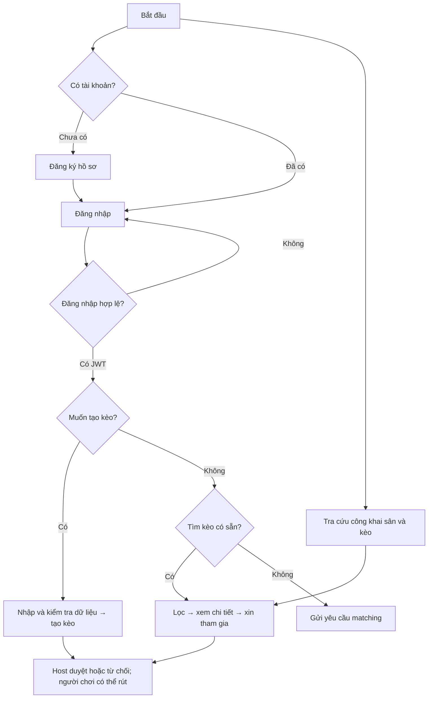
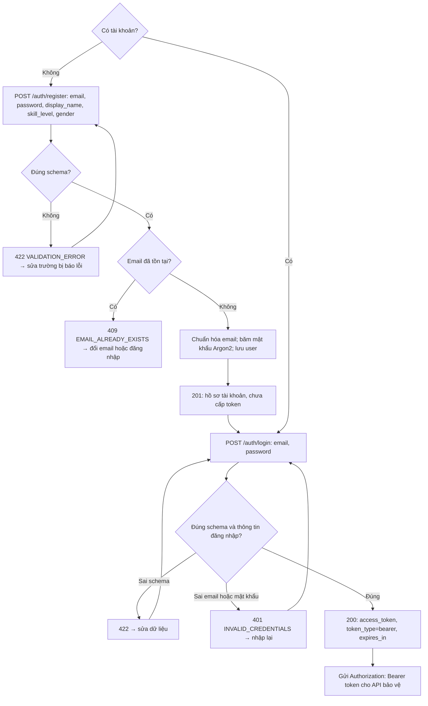
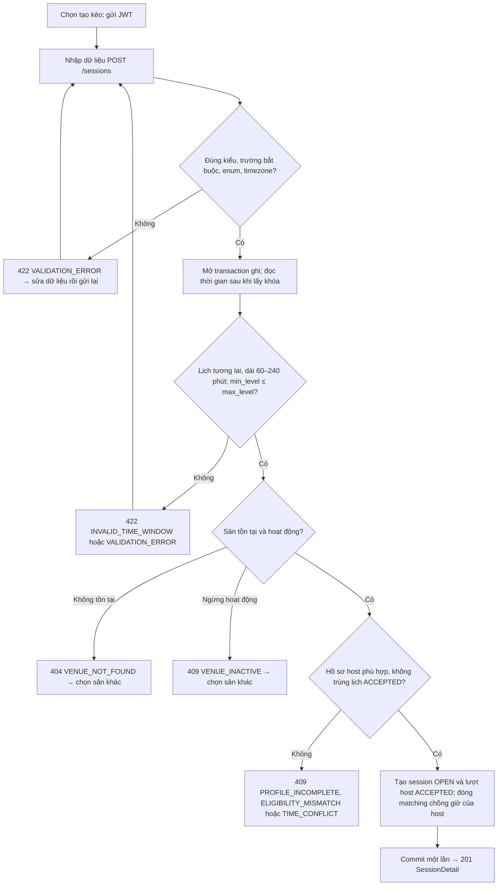
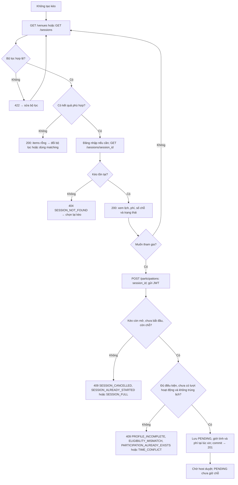
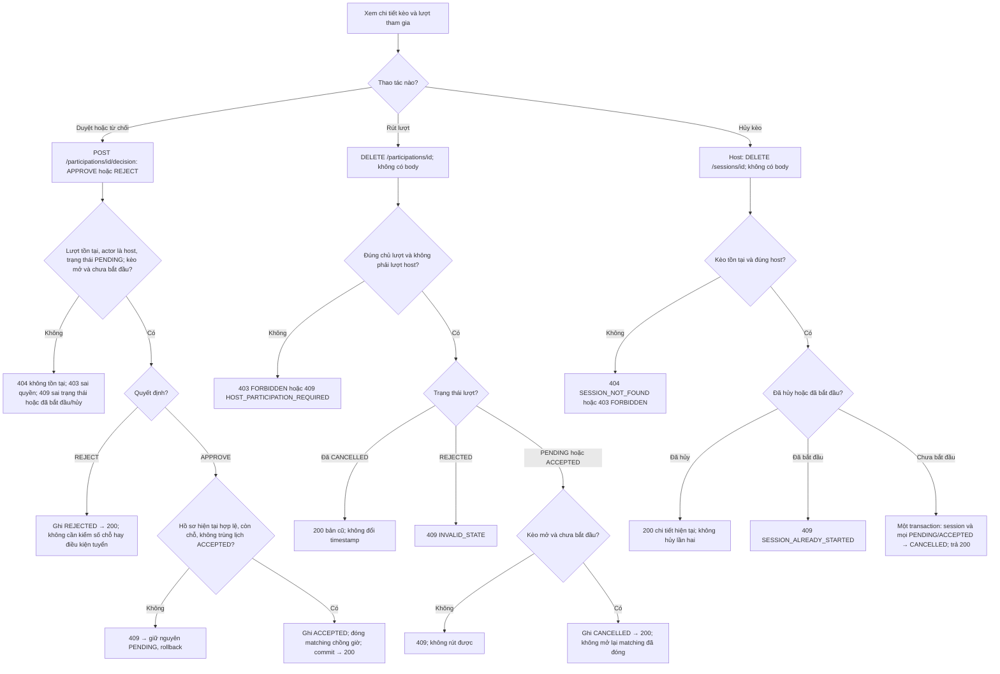
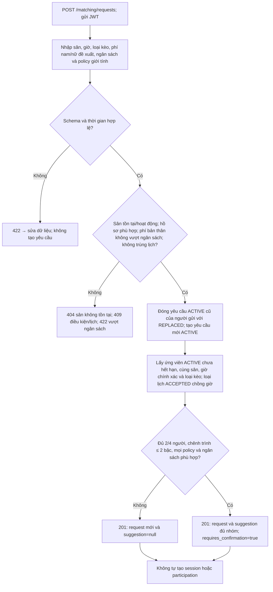
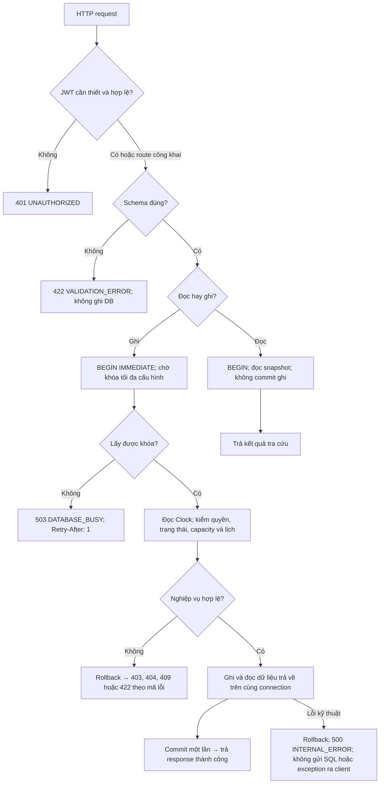

# MatchMate Backend

MatchMate hỗ trợ người chơi cầu lông tìm kèo phù hợp và chủ kèo tuyển thêm người. Pha 1 cung cấp backend REST JSON với Swagger UI để thử các luồng chức năng. Hệ thống tra cứu sân/kèo theo quận (`district_code`), không dùng GPS.

Phạm vi gồm **11 API nghiệp vụ, 5 bảng và 19 mức trình**. Ứng dụng quản lý hồ sơ, sân, kèo, lượt tham gia và gợi ý ghép nhóm; `/health` phục vụ kiểm tra tiến trình.

## Bài toán và nghiệp vụ

Người chơi cần tìm kèo còn chỗ, phù hợp điều kiện và không trùng lịch đã nhận. Chủ kèo cần duyệt người tham gia mà không vượt sức chứa. Hệ thống kiểm tra các điều kiện này cùng trạng thái kèo và lượt tham gia.

Người chơi là tài khoản đã đăng ký; host là người chơi tạo một kèo và quản lý yêu cầu của kèo đó, không phải vai trò quản trị riêng.

- Người chơi đăng ký hồ sơ, đăng nhập, tra cứu sân/kèo theo quận, trình độ, giới tính, lịch và phí.
- Chủ kèo (host) tạo kèo đơn/đôi với một sân, lịch tương lai cố định dài 60–240 phút và tự có một lượt `ACCEPTED`. Sức chứa là 2/4 người, tính cả host. Người chơi xin tham gia tạo `PENDING`, chưa giữ chỗ; host duyệt hoặc từ chối trước giờ bắt đầu.
- Khi duyệt phải kiểm lại điều kiện, chỗ và lịch `ACCEPTED`. Hai lịch nối tiếp được phép. Mức phí và giới tính lúc xin được giữ nguyên; đăng ký lại tạo lượt mới. Người chơi rút lượt của mình; host phải hủy cả kèo.
- Matching gợi ý đủ 2/4 người cùng sân, giờ chính xác và loại kèo; kiểm policy giới tính, ngân sách và chênh trình tối đa 2 bậc. Chưa đủ nhóm thì trả `suggestion=null`; gợi ý không tự giữ chỗ hoặc tạo participation.

Ngoài phạm vi Pha 1: frontend hoàn chỉnh, chat/thông báo đẩy, đặt sân thực tế, thanh toán/hoàn tiền, xác minh trình độ, Elo/AI và danh sách chờ. Mức phí công bố không phải bằng chứng thanh toán.

## Workflow người dùng

Sơ đồ mô tả cách dùng API qua Swagger hoặc một giao diện tích hợp sau này; Pha 1 chưa có frontend hoàn chỉnh. Người chưa đăng nhập vẫn được tra cứu sân/kèo công khai. Các thao tác tạo, xem chi tiết và tham gia cần JWT.



Mở các mục **Workflow chi tiết và mã nguồn** cuối README để xem trường nhập, nhánh lỗi, kết quả và đoạn code tương ứng.

## Công nghệ và tổ chức mã nguồn

Python 3.11+, FastAPI/Pydantic cho HTTP và schema, SQLAlchemy 2 cho ORM, SQLite cho dữ liệu; PyJWT HS256 và Argon2 cho đăng nhập. CI và Docker dùng Python 3.11.

Luồng xử lý: API → Service → Protocol → Repository → SQLite. Service xử lý nghiệp vụ; Protocol định nghĩa giao diện truy cập dữ liệu; Repository triển khai giao diện đó. Dependency ghép các thành phần tại biên ứng dụng. Domain và contract thuần Python; ORM không được đưa trực tiếp ra response.

| Thư mục | Vai trò |
|---|---|
| `app/features/auth` | Đăng ký, đăng nhập, JWT middleware |
| `app/features/discovery` | Tìm sân/kèo, matching |
| `app/features/sessions` | `session` quản lý kèo; `participation` xin/duyệt/rút |
| `app/domain`, `app/db` | Entity, enum, port, luật giờ; model, UTC, UoW và adapter ghi |
| `app/api`, `app/main.py` | Envelope lỗi, ghép router và dependency |
| `tests`, `scripts` | Test/fixture/Locust; seed và runner tải |

Dữ liệu gồm 5 bảng: `users`, `venues`, `sessions`, `participations`, `matching_requests`. DB có FK, CHECK và unique lượt hoạt động; không lưu counter sức chứa riêng. UTC được chuẩn hóa khi vào hệ thống, DB lưu TEXT cố định và API trả thời gian có `Z`.


## Chạy ứng dụng và kiểm thử

Từ thư mục repo:

```bash
python3 -m venv .venv
source .venv/bin/activate
python -m pip install -r requirements-dev.txt
python -m scripts.init_env
python -m scripts.seed
python -m uvicorn app.main:app --reload --no-access-log
```

`init_env` tạo `.env` với JWT secret ngẫu nhiên, giữ file nếu đã có; không commit file này. Seed tạo schema và 10 sân demo, không tạo tài khoản/kèo thật. App không tự seed hoặc reset DB khi khởi động.

Runtime đọc `DATABASE_URL` từ environment, mặc định `sqlite:///./app.db`; `SQLITE_BUSY_TIMEOUT_MS` mặc định 5000. Khi đổi DB, seed và app phải nhận cùng environment. Git đồng bộ code/seed, không đồng bộ dữ liệu DB giữa các máy.

```bash
python -m ruff check .
python -m ruff format --check .
python -m pytest -q
```

CI chạy lint, format và test. Test dùng SQLite file tạm riêng, bao phủ JWT/API, rollback, dữ liệu tại thời điểm đăng ký, tính lặp an toàn và sáu ca đồng thời. Khi chạy thêm test workload, cài `requirements-load.txt`. Chi tiết transaction và adapter nằm trong [tài liệu participation](docs/PARTICIPATIONS.md).

## API và file đặc tả

Đặc tả API lưu tại **[docs/openapi.json](docs/openapi.json)**, được xuất từ ứng dụng và có thể preview bằng [Swagger Editor](https://editor.swagger.io/). Khi chạy local, dùng [Swagger UI](http://127.0.0.1:8000/docs), [ReDoc](http://127.0.0.1:8000/redoc) hoặc [OpenAPI JSON](http://127.0.0.1:8000/openapi.json).

| FR | Method | Route | Quyền |
|---|---|---|---|
| FR-01 | POST | `/auth/register` | Public |
| FR-02 | POST | `/auth/login` | Public |
| FR-03 | GET | `/venues` | Public |
| FR-04 | GET | `/sessions` | Public; `host_me=true` cần JWT |
| FR-05 | POST | `/sessions` | JWT |
| FR-06 | GET | `/sessions/{session_id}` | JWT |
| FR-07 | DELETE | `/sessions/{session_id}` | Host |
| FR-08 | POST | `/participations` | JWT |
| FR-09 | POST | `/participations/{participation_id}/decision` | Host |
| FR-10 | DELETE | `/participations/{participation_id}` | Chủ lượt, không rút riêng lượt host |
| FR-11 | POST | `/matching/requests` | JWT |
| Kỹ thuật | GET | `/health` | Public, chỉ liveness |


## Triển khai và lưu ý cho Phase 2


**Đã hoàn thành phần Docker:** Dockerfile và Compose phục vụ build, seed và chạy backend, có healthcheck và volume lưu dữ liệu để bàn giao Phase 2.

SQLite chỉ có một writer nên tải ghi đồng thời có thể phải chờ hoặc gặp 503. Các thao tác phải kiểm tra và cập nhật dữ liệu trong cùng transaction; kết quả kiểm tải cần đối chiếu thêm các ràng buộc dữ liệu sau chạy.

Trên Kaggle CPU, **235 test đạt** khi cài thêm `requirements-load.txt`. Kiểm thử tải đo đủ 60 giây cho read 10/50/100 người và lifecycle 10 người, không lỗi request. Lifecycle 50 người gặp 503 khi warm-up, 100 người dừng ở login timeout nên chưa có số đo hợp lệ. Môi trường, số liệu và HTML/CSV/log nằm trong [báo cáo tải](docs/LOAD_TEST_RESULTS.md). Kết quả trên một máy dùng loopback là mốc tham khảo, chưa đại diện cho hệ thống production.


Các vấn đề chính khi tích hợp Phase 2: nhiều yêu cầu tranh chỗ cuối, duyệt đồng thời với hủy kèo, lịch chồng nhau và sai lệch múi giờ. Khi bổ sung giao diện hoặc thay tầng dữ liệu, cần giữ ràng buộc sức chứa/lịch, tính nguyên tử của transaction, quy ước UTC và quyền chủ kèo.

## Workflow chi tiết và mã nguồn

Phần mở rộng đối chiếu với code hiện tại. Đoạn code là trích đoạn từ các file được dẫn, không phải một triển khai khác. Với API bảo vệ, JWT thiếu/sai/hết hạn trả `401 UNAUTHORIZED`; cần đăng nhập lại rồi gửi lại yêu cầu. Lỗi nhập liệu không tự sửa hoặc tạo dữ liệu thay người dùng.

<details>
<summary><strong>1. Đăng ký và đăng nhập — FR-01, FR-02</strong></summary>



| Trường đăng ký | Ràng buộc |
|---|---|
| `email` | Email hợp lệ; bỏ khoảng trắng ngoài, chuyển chữ thường |
| `password` | Chuỗi 8–128 ký tự; chỉ lưu bản băm |
| `display_name` | Sau khi trim còn 1–80 ký tự |
| `skill_level` | Một trong 19 mã trình của `SkillLevel` |
| `gender` | `MALE` hoặc `FEMALE` |

Thiếu trường, sai kiểu, giá trị enum sai hoặc thừa trường đều trả 422. Đăng nhập chỉ nhận `email`, `password`; thông báo sai thông tin không tiết lộ email có tồn tại hay không.

- Schema kiểm hình dạng dữ liệu trước; service kiểm email trùng rồi băm mật khẩu. Đăng ký thành công chỉ tạo hồ sơ. Token được cấp sau bước đăng nhập và được middleware kiểm trước API bảo vệ.

</details>

<details>
<summary><strong>2. Chọn tạo kèo — nhập gì, nhập sai thì sao — FR-05</strong></summary>

Không chọn tạo kèo thì đi sang tìm kèo hoặc matching ở mục 3 và 5; không phát sinh session hay lượt host mới.



| Dữ liệu tạo kèo | Ràng buộc |
|---|---|
| `venue_id` | ID sân là số nguyên dương, sân tồn tại và đang hoạt động |
| `title`, `notes` | Tiêu đề sau trim 1–120 ký tự; ghi chú tùy chọn, tối đa 1000 ký tự |
| `starts_at`, `ends_at` | ISO 8601 có múi giờ; bắt đầu ở tương lai; thời lượng 60–240 phút |
| `play_type` | `SINGLES` → 2 người; `DOUBLES` → 4 người, đều tính host |
| `fee_male_vnd`, `fee_female_vnd` | Số nguyên VND không âm |
| `min_level`, `max_level` | Mã trình hợp lệ, min không cao hơn max; host nằm trong khoảng |
| `gender_policy` | `ANY` mặc định, hoặc `MALE_ONLY`/`FEMALE_ONLY`; host cũng phải phù hợp |

ID và phí không vượt miền INTEGER 64 bit của SQLite. `host_user_id`, capacity và trạng thái do hệ thống xác định, không phải trường cho người dùng tự gán. Khi lỗi, transaction rollback; không để lại session thiếu lượt host.

- Host là tài khoản lấy từ JWT. Sau khi các kiểm tra đạt, repository ghi cả kèo và lượt host trên cùng connection; router trả chi tiết kèo. Client không được coi một lỗi 409 là tạo kèo thành công.

</details>

<details>
<summary><strong>3. Không tạo kèo — tìm, xem và xin tham gia — FR-03, FR-04, FR-06, FR-08</strong></summary>



**Bộ lọc:** `district_code`, `venue_id`, `play_type`, `skill_level`, `gender`, `max_fee_vnd`, `available_from/available_to`, `only_available`, `host_me`, `limit/offset`. Hai mốc available phải cùng có hoặc cùng vắng, mốc đầu nhỏ hơn mốc cuối; thời gian có múi giờ, phí không âm, limit 1–100 và offset không âm. Tìm sân chỉ dùng quận và phân trang. `host_me=true` cần JWT và lấy kèo của tài khoản hiện tại.

**Detail:** trả số chỗ tính từ `ACCEPTED`, lượt của người xem và cờ `can_cancel/can_decide`; host nhận thêm danh sách quản lý. `AVAILABLE/FULL/STARTED/ENDED` là trạng thái hiển thị được tính từ lịch và số người, không phải bốn trạng thái session được ghi vào DB.

- Hệ thống kiểm lại dữ liệu khi nhận yêu cầu, không tin số chỗ đã xem trước đó. Xin tham gia chỉ tạo PENDING. Khi nhiều người cùng xin một chỗ, quyết định duyệt vẫn phải kiểm capacity lần nữa.

</details>

<details>
<summary><strong>4. Host duyệt/từ chối, người chơi rút hoặc host hủy — FR-07, FR-09, FR-10</strong></summary>



ID không hợp lệ, body quyết định thiếu/sai/thừa trường trả 422. Luồng rút/duyệt cũng trả 404 nếu không tìm thấy lượt hoặc kèo. Mỗi nhánh thành công trả chi tiết hiện tại, không trả lời thành công trước commit.

- Duyệt không chỉ đổi trạng thái; nó xác nhận lịch nên phải đóng matching chồng giờ trong cùng transaction. REJECT không chiếm chỗ. Rút và hủy có thể gọi lặp an toàn; đăng ký lại sau rút/từ chối tạo lượt mới, không sửa lịch sử cũ.

</details>

<details>
<summary><strong>5. Không chọn kèo có sẵn — gửi yêu cầu matching — FR-11</strong></summary>



Tên trường: `venue_id`, `starts_at`, `ends_at`, `play_type`, `proposed_fee_male_vnd`, `proposed_fee_female_vnd`, `budget_max_vnd`, `gender_policy` (mặc định `ANY`). ID/phí, thời lượng và múi giờ tuân theo giới hạn tương tự tạo kèo. Mức phí của nhóm gợi ý lấy theo đề xuất của người gọi và phải nằm trong ngân sách từng thành viên.

- Matching là gợi ý, không phải một lượt đặt chỗ. Không đủ nhóm là kết quả bình thường `suggestion=null`, không phải lỗi. Yêu cầu mới thay yêu cầu ACTIVE cũ; được xác nhận lịch ở tạo/duyệt kèo sẽ đóng matching liên quan.

</details>

<details>
<summary><strong>6. Từ HTTP đến DB — lỗi chung, commit và rollback</strong></summary>



- JWT middleware chạy trước router; thứ tự trả lỗi cụ thể còn phụ thuộc thứ tự kiểm tra trong service. Error envelope có `code`, `message`, `details`, `request_id` trong `error`; không đưa password/token hoặc câu SQL vào lỗi trả cho client.

- Hai host không thể cùng xác nhận chỗ cuối dựa trên một dữ liệu cũ. Thao tác sau lấy được khóa phải kiểm lại số người đã ACCEPTED. Nếu hết thời gian chờ, client nhận 503 rõ ràng; hệ thống không bỏ kiểm tra hoặc tự coi yêu cầu thành công.

</details>
