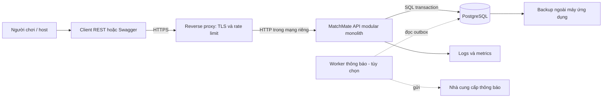
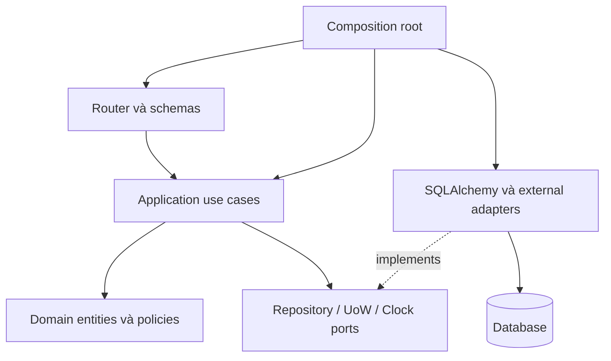

# Đề xuất kiến trúc MatchMate Phase 2

> Trạng thái: đề xuất, chưa triển khai. Phạm vi: backend hiện có; không mặc định bổ sung chat, thanh toán, đặt sân thực hay frontend. Ngày khảo sát: 15/11/2026.

## 1. Cơ sở thiết kế và hiện trạng

### 1.1. Bài toán

MatchMate phục vụ người chơi cầu lông: tìm sân/kèo, tạo kèo, xin tham gia, host duyệt/từ chối, rút lượt, hủy kèo và gợi ý nhóm. Phần khó không nằm ở CRUD mà ở việc giữ đúng sức chứa, tránh lịch chồng, kiểm quyền và xử lý các thao tác đồng thời.

Ràng buộc kế thừa từ [đặc tả Phase 1](../dac-ta.md):

- Kèo đơn có 2 người, kèo đôi có 4 người, gồm host; `PENDING` chưa giữ chỗ.
- Tạo kèo phải tạo luôn lượt host `ACCEPTED`; duyệt phải kiểm lại sức chứa, hồ sơ và lịch.
- Hủy kèo phải hủy các lượt còn hoạt động trong cùng transaction.
- Matching chỉ gợi ý, không tạo kèo và không giữ chỗ; thứ tự hiện tại là nhóm hợp lệ đầu tiên theo `created_at`, `id`.
- Giữ lịch sử lượt cũ và snapshot phí/giới tính lúc xin tham gia.

### 1.2. Những gì code đã có

- **Layered architecture theo feature:** `app/features/auth`, `discovery`, `sessions`; router gọi service và repository. Xem [tài liệu hiện trạng](../kien-truc.md).
- **Repository và ports:** [contracts discovery](../../app/features/discovery/contracts.py), [contracts participation](../../app/features/sessions/participation_contracts.py), [domain ports](../../app/domain/ports.py). Service phụ thuộc giao diện thuần Python.
- **Unit of Work:** [SqlAlchemyUnitOfWork](../../app/db/unit_of_work.py) có transaction đọc/ghi, commit và rollback; ghi SQLite mở bằng `BEGIN IMMEDIATE`.
- **Dependency injection và adapter:** [discovery dependencies](../../app/features/discovery/dependencies.py) lắp repository, clock và UoW; [auth dependencies](../../app/features/auth/dependencies.py) lắp password hasher và token issuer.
- **Data mapping:** [participation mapper](../../app/features/sessions/participation_mapper.py) và các hàm chuyển ORM record trong repository tách biểu diễn lưu trữ khỏi dữ liệu nghiệp vụ.
- **Bảo mật cơ bản:** JWT middleware, Argon2, kiểm host/chủ lượt trong service, schema validation và lỗi thống nhất. [Dockerfile](../../Dockerfile) đã chạy bằng user không phải root.
- **Kiểm thử kiến trúc và cạnh tranh:** [architecture test](../../tests/test_architecture.py), [concurrency tests](../../tests/sessions/test_concurrency.py). Test kiến trúc hiện chỉ kiểm import trực tiếp, chưa kiểm toàn bộ đồ thị phụ thuộc hay cấm xuyên module.

Không nên mô tả repo là “chưa có architecture hoặc pattern nào”. Mô tả chính xác hơn: đã có nền tảng phân lớp và persistence pattern, nhưng chưa thống nhất đầy đủ ranh giới, mục tiêu chất lượng và thiết kế vận hành khi tăng tải.

### 1.3. Khoảng trống cần xử lý

1. **Transaction ownership không thống nhất.** Participation và discovery mở UoW trong service; auth và session mở trong dependency. [Session router](../../app/features/sessions/session_router.py) còn lắp repository cụ thể. Điều này khiến cách gọi use case và thời điểm khóa phụ thuộc entry point.
2. **Khóa ghi SQLite toàn cục.** Chạy thêm API worker không loại bỏ một-writer bottleneck. [DB session](../../app/db/session.py) còn gắn với `sqlite3`, PRAGMA và `check_same_thread`.
3. **Matching giữ khóa trong lúc tính toán.** [Discovery service](../../app/features/discovery/service.py) lấy toàn bộ candidates và xét tổ hợp trước commit. Với kèo đôi, số tổ hợp tối đa là `n(n-1)(n-2)/6`; nhóm không có đáp án có thể phải xét hết.
4. **Module discovery có hai trách nhiệm:** truy vấn đọc và ghi matching request. [Session repository](../../app/features/sessions/session_repository.py) còn có thao tác đóng matching. Ranh giới sở hữu dữ liệu chưa rõ.
5. **Chưa có migration versioned trong cây file đã khảo sát.** Seed tạo bảng không thay thế migration. Schema có kiểu thời gian TEXT và partial index chỉ khai báo `sqlite_where`, cần thiết kế riêng khi chuyển DB.
6. **Vận hành mới ở mức demo.** `/health` chỉ là liveness; Compose một API, một volume SQLite; Uvicorn tắt access log. Chưa thấy cấu hình metrics, tracing, readiness DB, backup/restore hoặc rate limiting trong các file khảo sát.
7. **Auth route policy dựa trên danh sách regex.** Thêm endpoint có thể quên cập nhật danh sách ở [middleware](../../app/features/auth/middleware.py). Cần policy khai báo và test coverage cho mọi route.

## 2. Architectural drivers và kịch bản chất lượng

> Cập nhật sau khi nhận yêu cầu Phase 2: đã đọc báo cáo cũ từ Git local. Xem [đánh giá baseline](danh-gia-hieu-nang-baseline.md) để lấy số liệu và kế hoạch đo cùng cấu hình Kaggle CPU. Phần máy phát tải riêng/4 vCPU/8 GiB bên dưới là giả định ban đầu đã được thay thế; không dùng nó làm cấu hình nghiệm thu.

Ưu tiên: tính đúng đắn dữ liệu và quyền truy cập trước; sau đó là khả năng thay đổi, kiểm thử, hiệu năng và phục hồi. Không có số liệu mới trong lần khảo sát này. Link báo cáo tải cũ được nhắc trong `docs/cai-dat-va-tai.md` chưa được dùng làm bằng chứng định lượng.

Các ngưỡng dưới đây là giả thuyết nghiệm thu cần hiệu chỉnh sau baseline. Môi trường đo đề xuất: máy ứng dụng + DB tổng ngân sách 4 vCPU/8 GiB RAM, máy phát tải riêng, ghi rõ CPU thực tế, storage, phiên bản, số worker và pool size. Dataset: 10.000 user, 1.000 sân, 50.000 kèo, 200.000 lượt; có cả lịch sử và lịch tương lai. Chạy warm-up 2 phút, đo 10 phút, lặp 3 lần, lưu p50/p95/p99, throughput thực đạt, CPU/RAM và lock wait.

### QA-01 - Tính nhất quán khi cạnh tranh

- Nguồn/kích thích: nhiều host request cùng duyệt chỗ cuối hoặc duyệt một người vào hai kèo chồng giờ.
- Môi trường/thành phần: DB thật, nhiều connection độc lập, command participation.
- Phản ứng: một quyết định hợp lệ commit, quyết định xung đột đọc lại trạng thái và bị từ chối; lỗi giữa chừng rollback toàn bộ.
- Đo: 0 trường hợp vượt sức chứa, 0 người có hai lịch `ACCEPTED` chồng nhau qua ít nhất 1.000 lần chạy mỗi cặp race. Timeout hạ tầng được thống kê riêng, không tính thành thành công nghiệp vụ.

### QA-02 - Hiệu năng và mở rộng

- Nguồn/kích thích: tải 50 request/giây gồm 80% search/detail và 20% lifecycle write; thêm burst 100 request/giây trong 60 giây.
- Môi trường/thành phần: cấu hình tham chiếu bên trên, token cấp trước; login/register và matching benchmark riêng.
- Phản ứng: phục vụ có giới hạn concurrency, không tạo backlog vô hạn; chặn quá tải có chủ đích.
- Đo đề xuất ở tải ổn định: read p95 dưới 300 ms, lifecycle write p95 dưới 500 ms, lỗi 5xx dưới 1%. Báo riêng 401/409 dự kiến, 429 và request không phát được; không bỏ request timeout khỏi thống kê.
- Matching: thử bucket 10/50/100/200 candidates, gồm trường hợp không có nhóm; mục tiêu ban đầu p95 dưới 1 giây ở 100 candidates. Chưa đạt thì đo và tối ưu, không tự cắt kết quả.

### QA-03 - Khả năng thay đổi và kiểm thử

- Nguồn/kích thích: developer thay thuật toán chọn nhóm hoặc thêm adapter PostgreSQL.
- Môi trường/thành phần: CI, matching policy và persistence boundary.
- Phản ứng: giữ contract API; domain/application không import framework hay DB.
- Đo: thêm strategy không sửa router; chuyển adapter không sửa luật eligibility/capacity; không có import cycle hoặc module gọi repository nội bộ của module khác. Dùng fake clock/repository chạy được unit test nghiệp vụ.

### QA-04 - Bảo mật

- Nguồn/kích thích: người đã đăng nhập gửi ID của người khác để duyệt/rút/hủy, hoặc client gửi dồn login.
- Môi trường/thành phần: ingress, auth và application service.
- Phản ứng: từ chối trước mutation; giới hạn request; không lộ token, password hoặc SQL trong log/error.
- Đo: toàn bộ bộ test quyền đối tượng không có mutation trái phép; burst vượt cấu hình trả 429 và retry metadata phù hợp; test endpoint mới thất bại nếu chưa khai báo policy public/protected.

### QA-05 - Phục hồi và quan sát

- Nguồn/kích thích: API restart hoặc DB mất kết nối, restore từ backup trên môi trường thử nghiệm.
- Môi trường/thành phần: container, readiness, DB và telemetry.
- Phản ứng: readiness ngừng nhận traffic khi DB không phục vụ; transaction dang dở rollback; correlation ID nối được request và lỗi.
- Đo đề xuất: phát hiện DB unavailable trong 30 giây; restart API trở lại phục vụ trong 60 giây khi DB khỏe; diễn tập restore đạt RTO 30 phút, RPO 24 giờ với backup hằng ngày. Đây không phải cam kết HA hoặc SLO đã đạt.

## 3. Kiểu kiến trúc được đề xuất

### 3.1. Modular monolith và phân lớp trong module

Giữ một application deployable. Tách theo năng lực nghiệp vụ; bên trong có API, application use case, domain và infrastructure adapter. Phân lớp là tổ chức logic, không đồng nghĩa bốn service hay bốn máy.

Luồng gọi runtime: router → use case → domain policy / repository port → adapter → DB. Chiều phụ thuộc source: API và adapter phụ thuộc contract/domain; application không import adapter. Composition root biết các implementation để lắp chúng.

Không ép mọi query đơn giản đi qua nhiều class chỉ để forward. Query service có thể gọi read repository qua port và trả DTO thẳng; tránh architecture sinkhole.

### 3.2. Các module và quyền sở hữu

- **Identity (`auth`)** sở hữu tài khoản, credential và cấp/kiểm token. Công bố `PlayerProfileReader` trả DTO tối thiểu cho nghiệp vụ. Không truyền password hash ra ngoài module.
- **Catalog** sở hữu sân và trạng thái hoạt động. Phase 2 có thể chỉ tách logic trong code, chưa cần API quản trị sân mới.
- **Sessions** sở hữu kèo và participation cùng nhau. Đây là ranh giới bảo toàn sức chứa và vòng đời kèo; không tách participation thành microservice.
- **Matching** sở hữu matching request, luật tương thích và chiến lược chọn nhóm; tách khỏi discovery ở mức trách nhiệm.
- **Discovery** là read facade cho tìm sân/kèo; read adapter được join bảng phục vụ DTO theo contract đọc đã thống nhất, không ghi bảng của module khác.
- **Notifications (tùy chọn)** chỉ nhận sự kiện đã commit để gửi thông báo; không quyết định chỗ hoặc trạng thái tham gia.

Các module vẫn dùng chung một DB để giữ transaction xuyên thao tác. Quyền sở hữu được cưỡng chế ở code/review/test, chưa phải phân quyền DB riêng từng module. Sessions gọi port đóng matching do Matching cung cấp; implementation dùng cùng UoW, không tự commit. Đây là coupling có chủ đích để giữ invariant hiện tại.

`shared` chỉ giữ ID, clock và lỗi nền tảng thực sự dùng chung. Không chuyển toàn bộ entity của các module vào một “common” package. Không đổi thư mục hàng loạt trước khi ranh giới đã được test.

### 3.3. View ngữ cảnh và triển khai mục tiêu



Baseline Phase 2 chỉ cần ingress + API + PostgreSQL. Worker được thêm khi có yêu cầu thông báo; Redis không bắt buộc. Triển khai một máy bằng Compose phù hợp demo nhưng vẫn là single point of failure. Tăng số API replica chỉ sau khi kiểm chứng transaction trên PostgreSQL và giới hạn tổng connection pool. HA của ingress/DB cần ngân sách và thiết kế riêng.

### 3.4. View component và phụ thuộc



Cấu trúc minh họa, chưa phải yêu cầu tạo code ngay:

```text
app/
  bootstrap/                 # lắp app, dependencies, config
  modules/
    identity/
    catalog/
    sessions/
      api/                   # router và Pydantic
      application/           # create, approve, withdraw, cancel; ports và DTO
      domain/                # capacity, eligibility, transitions
      infrastructure/        # SQLAlchemy repository và mapper
    matching/
    discovery/               # query use cases và read adapters
  infrastructure/            # engine, UoW implementation, telemetry
  shared/                    # clock, ID và lỗi tối thiểu
```

Quy tắc kiểm chứng: không import API/ORM trong application/domain; không import infrastructure của module khác; không dependency cycle; router không tự tạo engine/UoW/repository; module giao tiếp bằng port/DTO và các use case không mở UoW lồng nhau.

## 4. Pattern nào dùng và dùng ở đâu

### 4.1. Cốt lõi Phase 2

**Repository + Unit of Work + Data Mapper — kế thừa và chuẩn hóa.** Repository biểu đạt thao tác nghiệp vụ (`count_accepted`, `has_overlap`), không ép vào generic CRUD repository. UoW bao toàn bộ use case; mapper trả DTO/entity thuần; repository flush khi cần nhưng không commit. Mục tiêu: atomicity và thay adapter mà không đưa SQL vào nghiệp vụ.

**Dependency Injection / Ports and Adapters — hoàn thiện nền tảng đã có.** Port do phía sử dụng định nghĩa; composition root inject adapter. Chuẩn hóa `Clock`, `PlayerProfileReader`, repository và matching writer. Lợi ích: unit test độc lập framework. Chi phí: thêm contract, cần tránh tạo interface cho mọi hàm.

**Strategy — bổ sung cho matching.** Tách `MatchingStrategy.suggest(caller, request, candidates)` thuần Python. Strategy mặc định giữ đúng thuật toán first-valid hiện hành. Strategy xếp hạng theo độ gần trình độ chỉ là thử nghiệm sau, có version và test riêng, không tự đổi hành vi API. Không cần factory framework; chọn strategy qua cấu hình ở composition root.

**Policy/Specification đơn giản — gom luật eligibility.** Dùng hàm/đối tượng thuần cho giới tính, trình độ, khoảng thời gian và ngân sách, tái sử dụng khi phù hợp giữa Sessions và Matching. Phải giữ khác biệt: matching dùng rank spread và ngân sách toàn nhóm; session dùng khoảng min/max của host. Không cưỡng ép hai luật khác nhau thành một predicate.

**CQRS ở mức logic — tách command/query, cùng DB.** Command giữ transaction/invariant; query trả DTO tối ưu bằng join/aggregate. Không có replica hoặc projection bất đồng bộ nên chưa tự tạo eventual consistency. Đây là mức áp dụng tối thiểu, không phải CQRS phân tán đầy đủ.

**Gatekeeper / Gateway Offloading ở mức vừa đủ.** Reverse proxy lo TLS, giới hạn body/tần suất và request timeout. Backend vẫn kiểm JWT và quyền đối tượng; không tin header user do client tự gửi. Không cần mua hoặc dựng nền tảng API Gateway riêng cho một backend.

### 4.2. Chỉ thêm khi có nhu cầu chứng minh được

- **Transactional Outbox + consumer idempotency:** khi thêm notification; ghi event cùng transaction, gửi sau commit. Giải quyết khoảng hở giữa commit DB và publish. Không dùng để thay thao tác đóng matching bắt buộc đồng bộ.
- **Queue-based Load Leveling:** cho notification hoặc job nặng có API bất đồng bộ được đặc tả rõ. Đưa approve vào queue sẽ đổi ngữ nghĩa phản hồi, không áp dụng ở Phase 2 cốt lõi.
- **Adapter / Anti-corruption Layer:** khi kết nối nhà cung cấp sân, email hoặc thanh toán thật. Chuyển DTO/lỗi của bên ngoài sang contract nội bộ; không để SDK lan vào domain.
- **Timeout + Circuit Breaker:** cho lời gọi mạng tới nhà cung cấp nếu được thêm. Không thay transaction rollback bằng circuit breaker; không mở retry vô hạn.
- **Cache-aside:** chỉ sau profiling, ưu tiên catalog công khai ít đổi. Cache TTL đề xuất 60 giây, invalidate khi cập nhật sân, chấp nhận stale đã công bố. Không dùng cache để quyết định sức chứa, kiểm quyền hoặc lịch chồng; không cache chung response có `management`/`my_participations`.

### 4.3. Chưa chọn

- Microservices/service-based deployment: tăng chi phí transaction phân tán và vận hành trong khi nghiệp vụ kèo/lượt gắn chặt. Xem lại khi có nhóm phát triển độc lập hoặc bằng chứng cần scale một module riêng.
- Event sourcing: dữ liệu hiện tại là state + lịch sử lượt, không phải event store. Audit log/outbox không biến hệ thống thành event sourcing. Chưa có yêu cầu replay toàn bộ lịch sử để biện minh chi phí.
- Sharding và index table riêng: ưu tiên index quan hệ và tối ưu query trước. B-tree index trong PostgreSQL không đồng nghĩa pattern Index Table của bài giảng.
- BFF/Gateway Aggregation: chưa có frontend với nhu cầu trải nghiệm khác nhau. Endpoint detail hiện tại đủ phục vụ luồng cơ bản.
- Microkernel, sidecar/service mesh, Valet Key: chưa có plugin runtime, giao tiếp nhiều service hoặc upload file. Không thêm chỉ để minh họa đủ tên pattern.
- State pattern nhiều class: bốn trạng thái participation còn nhỏ; transition policy + test rõ ràng là đủ. Có thể xem lại khi workflow phát triển.

### 4.4. Lộ trình mở rộng sau transaction và PostgreSQL

**Định hướng đã được người dùng đồng ý:** hoàn thiện transaction và dữ liệu trước, sau đó mở rộng theo nút thắt đo được. Đây là đồng ý về lộ trình thiết kế, chưa phải triển khai các thành phần bên dưới. Không coi tất cả công nghệ là một bộ bắt buộc.

1. **Đo lại để xác định giới hạn mới.** Dùng cùng cấu hình Kaggle CPU, dataset và workload theo [kế hoạch benchmark](danh-gia-hieu-nang-baseline.md). Đo successful throughput, p95/p99, lỗi, CPU/RAM từng process, thời gian chờ khóa và invariant. Chọn từng cải tiến từ kết quả này, không thêm nhiều thành phần cùng lúc rồi gán nguyên nhân tăng tốc.
2. **Thử Redis nếu đọc lặp là nút thắt.** Ưu tiên cache danh sách sân theo quận; chỉ cache tìm kèo khi chấp nhận độ trễ dữ liệu và đã thiết kế TTL/invalidation. Đo cả cache lạnh, cache nóng, hit rate và khi Redis unavailable. Quyết định duyệt, sức chứa, lịch chồng và quyền luôn kiểm bằng DB. Redis cũng có thể phục vụ rate limit dùng chung khi nhiều replica, nhưng đó là nhu cầu vận hành riêng, không mặc nhiên là tối ưu query.
3. **Thêm outbox + worker nếu có notification hoặc công việc phù hợp bất đồng bộ.** Bắt đầu với outbox trong PostgreSQL và worker polling; chỉ gửi thông báo sau commit, có retry, lease và deduplication. Không chuyển invariant nghiệp vụ sang xử lý trễ. Đo response latency, độ trễ hoàn thành job, backlog và khả năng phục hồi sau crash.
4. **Cô lập matching thành worker/process riêng nếu CPU matching ảnh hưởng API.** Trước hết tối ưu strategy và đo CPU/latency dưới tải hỗn hợp. Process riêng giúp cô lập thực thi nhưng chưa cần trở thành microservice; vẫn chia sẻ ngân sách CPU/RAM cố định. Nếu xử lý bất đồng bộ, phải đặc tả job ID, trạng thái, timeout, kết quả stale và ownership trước khi đổi endpoint đồng bộ. Đo cả latency API lẫn thời gian có kết quả matching, không chỉ thời gian nhận job.
5. **Chỉ xem xét kiến trúc phân tán khi có điều kiện tương ứng:**
   - **Microservices:** có nhu cầu triển khai/scale độc lập được chứng minh. Notification hoặc Matching là ứng viên; Sessions và Participation tiếp tục chung ranh giới transaction. Tách service không tạo thêm tài nguyên trên cùng máy Kaggle.
   - **Kafka:** có nhiều consumer độc lập, cần lưu/replay luồng sự kiện hoặc cơ chế queue hiện tại đã bộc lộ giới hạn. Nhu cầu gửi notification đơn giản chưa đủ để chọn Kafka.
   - **Kubernetes:** có nhu cầu orchestration, rollout và phục hồi cho nhiều thành phần/replica; đánh giá như cải tiến vận hành, không tuyên bố nó làm query hoặc thuật toán nhanh hơn.
   - **Sharding:** một PostgreSQL đã tối ưu vẫn không đáp ứng dung lượng/tải và có phương án phân chia giữ đúng invariant xuyên shard. Với MatchMate, chia theo sân hay user đều làm kiểm sức chứa/lịch chồng phức tạp; chưa có căn cứ triển khai.

Event sourcing được xem xét riêng khi có yêu cầu tái dựng trạng thái từ lịch sử sự kiện; nó không phải bước tiếp theo mặc định của lộ trình tăng hiệu năng. Outbox không bắt buộc đi kèm event sourcing.

Mỗi thử nghiệm mở rộng phải ghi giả thuyết, baseline, kết quả trước/sau và chi phí vận hành; chỉ giữ thay đổi khi đạt mục tiêu đã đặt ra và không phá tính đúng đắn. Các nhánh không đáp ứng điều kiện được hoãn, không cần triển khai cho đủ tên pattern. Xem [mốc M5](adr-va-lo-trinh.md#m5---mở-rộng-theo-bằng-chứng-sau-transaction-và-postgresql) để đưa vào backlog.

## 5. Bảo mật và vận hành

Trust boundary: Internet → ingress → backend → DB. Chỉ ingress public; DB và metrics ở mạng riêng. Cấu hình proxy header chỉ tin ingress đã biết. CORS chỉ mở các origin client được phép khi có frontend; CORS không thay auth.

Giữ JWT HS256/Argon2 hiện tại trong phạm vi một backend; quản lý secret ngoài image và log, thiết kế luân chuyển khóa có giai đoạn tương thích. Quyền host/chủ lượt được kiểm trong use case sau khi đọc tài nguyên. Policy endpoint phải khai báo rõ public/protected và kiểm bằng test; giữ hành vi 401 trước 422 đã đặc tả hoặc ghi nhận thay đổi contract riêng.

Rate limit đề xuất ban đầu: login theo IP và định danh tài khoản đã chuẩn hóa, có cửa sổ ngắn để tránh brute force; write theo user; public search theo IP. Ngưỡng cụ thể phải qua thử tải và đánh giá người dùng chung NAT. Tránh lockout tài khoản vô hạn có thể bị lợi dụng để gây từ chối dịch vụ. Nhiều replica cần bộ đếm chung hoặc giới hạn tập trung ở ingress.

Log cấu trúc có request ID, route template, status, duration và error code; không ghi Authorization/password/body nhạy cảm. Metrics gồm p95, 5xx, 429, DB pool wait, lock wait, transaction duration và candidate count. Không dùng user ID hoặc URL chứa ID làm label metrics gây cardinality cao. Audit mutation ghi actor, target, action, kết quả và thời gian, có retention và quyền đọc rõ ràng.

Giữ `/health` làm liveness, thêm readiness kiểm DB bằng query nhỏ với timeout. Không restart container liên tục chỉ vì DB gián đoạn. Backup phải ra ngoài volume/host ứng dụng và có restore drill. Container restart policy, resource limits, shutdown grace và pipeline migration cần được thiết kế cùng release; Docker tự nó không tạo HA.

## 6. Liên hệ học liệu trong thư mục

Các số trang dưới đây là thứ tự trang PDF, bắt đầu từ 1. Tài liệu này diễn giải áp dụng cho MatchMate, không khẳng định toàn bộ thiết kế có sẵn trong slide.

- `1-Introduction to SA.pdf`, trang 3–13, 20–32: kiến trúc là các quyết định quan trọng và quan hệ giữa cấu trúc với thuộc tính chất lượng → hiện trạng, drivers và quyết định có lý do.
- `2-Quality%20Attributes-v2.5.pdf`, trang 5–26: trade-off, availability, deployability, modifiability, performance và security → các kịch bản QA-01 đến QA-05.
- `2.1 - Docker.pdf`, trang 2–8: image/container, đóng gói và GitHub Actions → kế thừa Docker, bổ sung release/migration/health thay vì coi container là kiến trúc nghiệp vụ.
- `3-Kieu kien truc.pdf`, trang 3–7, 16–22: layered, sinkhole, service-based và event-driven → phân lớp logic trong monolith, event chỉ dành cho side effect phù hợp.
- `3.1-Persistence-Layer.pdf`, trang 2–9: persistence boundary, Repository/UoW, Data Mapper và migration → chuẩn hóa transaction và kế hoạch DB.
- `4-Design patterns.pdf`, trang 2–6: ACL, BFF, circuit breaker, queue-based load leveling và rate limiting → lựa chọn theo nhu cầu ở mục 4, không áp dụng hàng loạt.
- `5-Designing Architecture.pdf`, trang 3–16, 21–29: ADD, mục tiêu, key scenarios, candidate solutions, tương tác giữa lớp → cấu trúc bộ đề xuất và các spike trong lộ trình.
- `DB - Design pattern.pdf`, trang 3–21: CQRS, event sourcing, index table, sharding → tách đọc/ghi mức logic; trì hoãn các cơ chế phân tán chưa cần.
- `Thiết kế cho bảo mật - Design pattern.pdf`, trang 3–16: Gatekeeper, Valet Key, Sidecar và Gateway → ingress bảo vệ biên, backend giữ kiểm quyền đối tượng.

Xem tiếp [thiết kế dữ liệu](du-lieu-va-nhat-quan.md) và [ADR/lộ trình](adr-va-lo-trinh.md).
