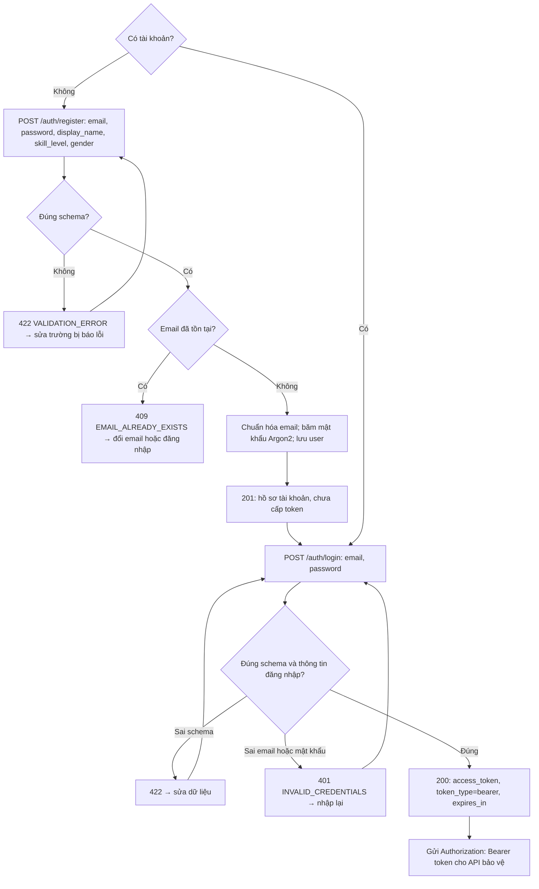
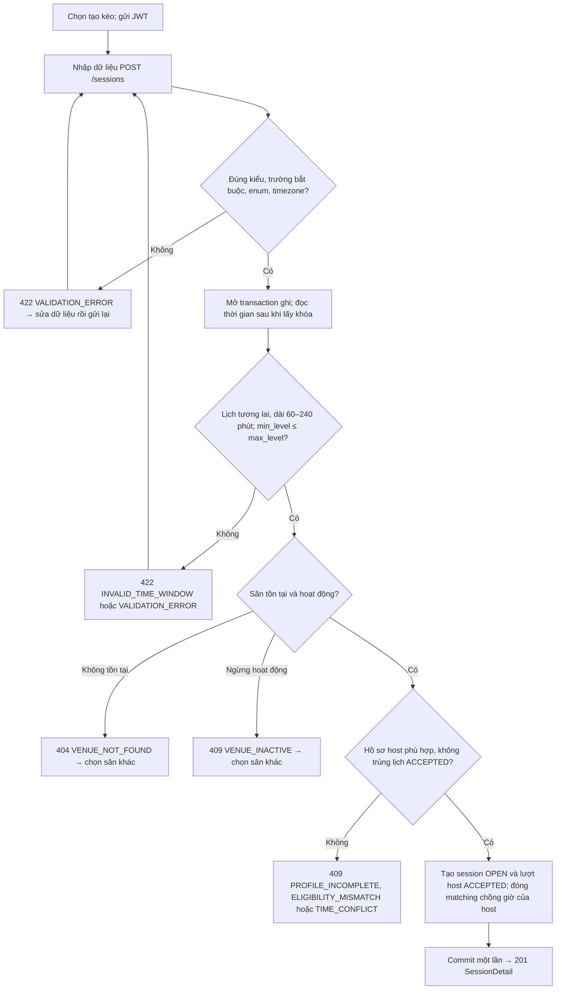
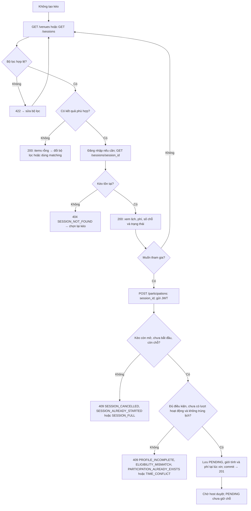
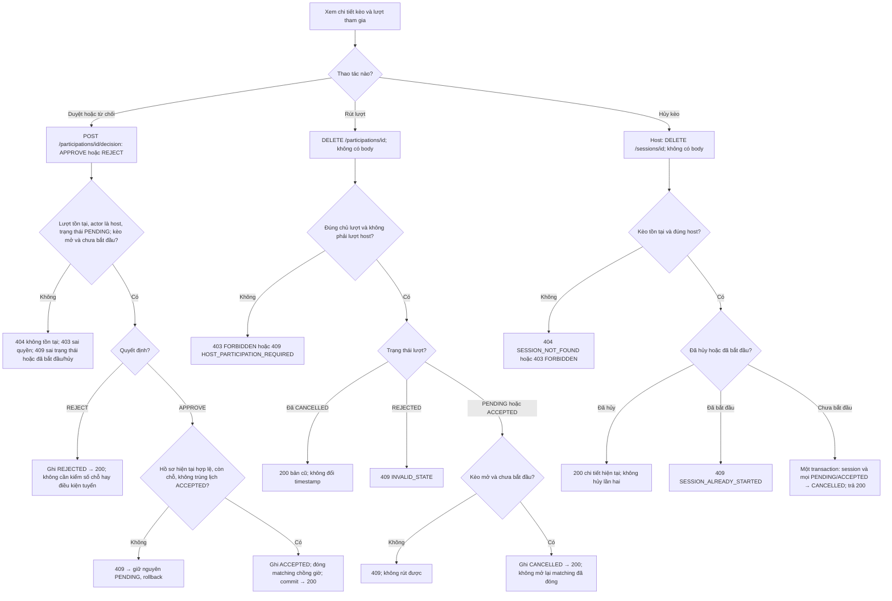
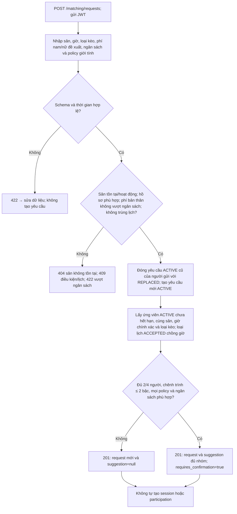
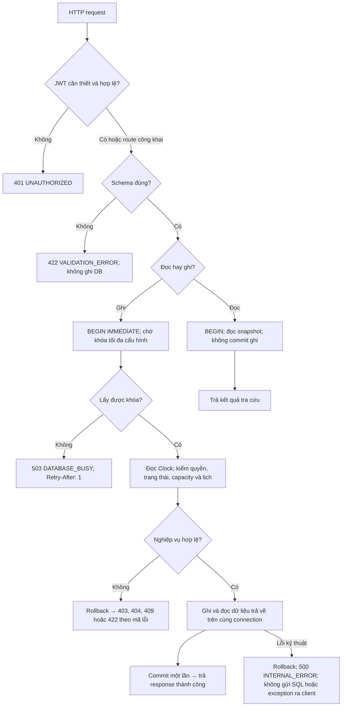

# Luồng nghiệp vụ chi tiết

Với API bảo vệ, JWT thiếu/sai/hết hạn trả `401 UNAUTHORIZED`; cần đăng nhập lại rồi gửi lại yêu cầu. Lỗi nhập liệu không tự sửa hoặc tạo dữ liệu thay người dùng.

<strong>1. Đăng ký và đăng nhập — FR-01, FR-02</strong>

| Trường đăng ký | Ràng buộc |
|---|---|
| `email` | Email hợp lệ; bỏ khoảng trắng ngoài, chuyển chữ thường |
| `password` | Chuỗi 8–128 ký tự; chỉ lưu bản băm |
| `display_name` | Sau khi trim còn 1–80 ký tự |
| `skill_level` | Một trong 19 mã trình của `SkillLevel` |
| `gender` | `MALE` hoặc `FEMALE` |

Thiếu trường, sai kiểu, giá trị enum sai hoặc thừa trường đều trả 422. Đăng nhập chỉ nhận `email`, `password`; thông báo sai thông tin không tiết lộ email có tồn tại hay không.

- Schema kiểm hình dạng dữ liệu trước sau đó service kiểm email trùng rồi băm mật khẩu. Đăng ký thành công chỉ tạo hồ sơ. Token được cấp sau bước đăng nhập và được middleware kiểm trước API bảo vệ.

<strong>2. Chọn tạo kèo — nhập gì, nhập sai thì sao — FR-05</strong>

Không chọn tạo kèo thì đi sang tìm kèo hoặc matching ở mục 3 và 5.

| Dữ liệu tạo kèo | Ràng buộc |
|---|---|
| `venue_id` | ID sân là số nguyên dương, sân tồn tại và đang hoạt động |
| `title`, `notes` | Tiêu đề sau trim 1–120 ký tự; ghi chú tùy chọn, tối đa 1000 ký tự |
| `starts_at`, `ends_at` | ISO 8601 có múi giờ; bắt đầu ở tương lai; thời lượng 60–240 phút |
| `play_type` | `SINGLES` → 2 người; `DOUBLES` → 4 người, đều tính host |
| `fee_male_vnd`, `fee_female_vnd` | Số nguyên VND không âm |
| `min_level`, `max_level` | Mã trình hợp lệ, min không cao hơn max; host nằm trong khoảng |
| `gender_policy` | `ANY` mặc định, hoặc `MALE_ONLY`/`FEMALE_ONLY`; host cũng phải phù hợp |

 `host_user_id`, capacity và trạng thái do hệ thống xác định. Khi lỗi, transaction rollback; không để lại session thiếu lượt host.

- Host là tài khoản lấy từ JWT. Sau khi các kiểm tra đạt, repository ghi cả kèo và lượt host trên cùng connection; router trả chi tiết kèo. Client không được coi một lỗi 409 là tạo kèo thành công.

<strong>3. Không tạo kèo — tìm, xem và xin tham gia — FR-03, FR-04, FR-06, FR-08</strong>

**Bộ lọc:** `district_code`, `venue_id`, `play_type`, `skill_level`, `gender`, `max_fee_vnd`, `available_from/available_to`, `only_available`, `host_me`, `limit/offset`. Hai mốc available phải cùng có hoặc cùng vắng, mốc đầu nhỏ hơn mốc cuối; thời gian có múi giờ, phí không âm, limit 1–100 và offset không âm. Tìm sân chỉ dùng quận và phân trang. `host_me=true` cần JWT và lấy kèo của tài khoản hiện tại.

**Detail:** trả số chỗ tính từ `ACCEPTED`, lượt của người xem và cờ `can_cancel/can_decide`; host nhận thêm danh sách quản lý. `AVAILABLE/FULL/STARTED/ENDED` là trạng thái hiển thị được tính từ lịch và số người, không phải bốn trạng thái session được ghi vào DB.

- Hệ thống kiểm lại dữ liệu khi nhận yêu cầu, không tin số chỗ đã xem trước đó. Xin tham gia chỉ tạo PENDING. Khi nhiều người cùng xin một chỗ, quyết định duyệt vẫn phải kiểm capacity lần nữa.

<strong>4. Host duyệt/từ chối, người chơi rút hoặc host hủy — FR-07, FR-09, FR-10</strong>

ID không hợp lệ, body quyết định thiếu/sai/thừa trường trả 422. Luồng rút/duyệt cũng trả 404 nếu không tìm thấy lượt hoặc kèo. Mỗi nhánh thành công trả chi tiết hiện tại, không trả lời thành công trước commit.

- Duyệt không chỉ đổi trạng thái; nó xác nhận lịch nên phải đóng matching chồng giờ trong cùng transaction. REJECT không chiếm chỗ. Rút và hủy có thể gọi lặp an toàn; đăng ký lại sau rút/từ chối tạo lượt mới, không sửa lịch sử cũ.

<strong>5. Không chọn kèo có sẵn — gửi yêu cầu matching — FR-11</strong>

Tên trường: `venue_id`, `starts_at`, `ends_at`, `play_type`, `proposed_fee_male_vnd`, `proposed_fee_female_vnd`, `budget_max_vnd`, `gender_policy` (mặc định `ANY`). ID/phí, thời lượng và múi giờ tuân theo giới hạn tương tự tạo kèo. Mức phí của nhóm gợi ý lấy theo đề xuất của người gọi và phải nằm trong ngân sách từng thành viên.

- Matching là gợi ý, không phải một lượt đặt chỗ. Không đủ nhóm là kết quả bình thường `suggestion=null`. Yêu cầu mới thay yêu cầu ACTIVE cũ; được xác nhận lịch ở tạo/duyệt kèo sẽ đóng matching liên quan.

<strong>6. Từ HTTP đến DB — lỗi chung, commit và rollback</strong>

- JWT middleware chạy trước router; thứ tự trả lỗi cụ thể còn phụ thuộc thứ tự kiểm tra trong service. Error envelope có `code`, `message`, `details`, `request_id` trong `error`; không đưa password/token hoặc câu SQL vào lỗi trả cho client.

- Hai yêu cầu duyệt không thể cùng xác nhận chỗ cuối dựa trên một dữ liệu cũ. Thao tác sau lấy được khóa phải kiểm lại số người đã ACCEPTED. Nếu hết thời gian chờ, client nhận 503 rõ ràng; hệ thống không bỏ kiểm tra hoặc tự coi yêu cầu thành công.

