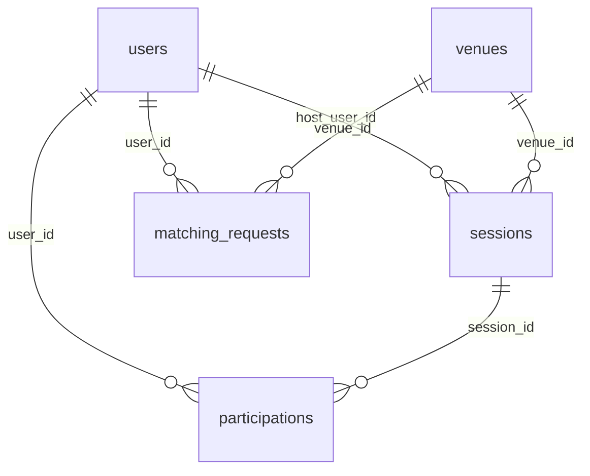

# Kiến trúc và dữ liệu

Python 3.11+, FastAPI, Pydantic, SQLAlchemy 2, SQLite. Đăng nhập bằng JWT HS256, mật khẩu băm Argon2.

## Cấu trúc code

```text
app/
├── main.py        ghép router, middleware, xử lý lỗi
├── config.py      đọc biến môi trường
├── api/           xử lý lỗi HTTP dùng chung
├── domain/        enum, entity, luật thời gian, Protocol (Python thuần)
├── db/            model SQLAlchemy, session, UnitOfWork
└── features/
    ├── auth/        đăng ký, đăng nhập, JWT middleware
    ├── discovery/   tìm sân, tìm kèo, matching
    └── sessions/    kèo (session_*) và lượt tham gia (participation_*)
```

Ba tầng: router (API), service (nghiệp vụ), repository (truy cập dữ liệu). Mỗi module có router, `schemas` (dữ liệu vào/ra HTTP), `service`, `contracts` (kiểu dữ liệu và `Protocol` mà service dùng), `repository` và `dependencies` (lắp ghép). `sessions` gom kèo và lượt tham gia vào một module vì tạo kèo, xin, duyệt và hủy dùng chung một transaction. Trong `sessions`, tên file có tiền tố, ví dụ `session_service.py` và `participation_service.py`.

## Luật phụ thuộc

- `app/domain/`, mọi `service.py` và mọi `contracts.py` không import `fastapi`, `starlette`, `pydantic`, `sqlalchemy`, `sqlite3` hay `app.db`. `tests/test_architecture.py` kiểm luật này.
- Repository dùng SQLAlchemy ORM và trả dữ liệu thuần cho service.
- Lỗi nghiệp vụ là `DomainError` kèm mã lỗi. `app/api/error_handlers.py` đổi mã đó sang HTTP status.
- JWT được kiểm một lần ở middleware. Endpoint không tự giải mã token. Quyền trên từng bản ghi (host, chủ lượt) do service kiểm.

## Transaction

`app/db/unit_of_work.py` quản lý transaction cho service:

- Thao tác ghi mở bằng `BEGIN IMMEDIATE`, đọc đồng hồ sau khi có khóa. Các bước kiểm tra và ghi dùng chung một connection, commit một lần. Lỗi thì rollback.
- Thao tác đọc mở bằng `BEGIN` để cả request nhìn cùng một snapshot.
- SQLite chỉ có một writer. Chờ khóa quá `SQLITE_BUSY_TIMEOUT_MS` (mặc định 5000) thì trả `503 DATABASE_BUSY`.

Đăng ký và tạo kèo mở transaction ghi ngay trong dependency, trước khi Pydantic kiểm body. Body sai vẫn không ghi gì, nhưng khi DB đang bận, client nhận 503 thay vì 422.

Hai lịch chồng nhau khi `start_a < end_b` và `start_b < end_a`, nên hai lịch nối tiếp không bị coi là chồng.

## Dữ liệu



Năm bảng: `users`, `venues`, `sessions`, `participations`, `matching_requests`. Cột đầy đủ ở `app/db/models.py`. Giờ lưu UTC dạng TEXT. Số chỗ của kèo không có cột riêng, được đếm từ các lượt `ACCEPTED`.

Ràng buộc do DB giữ:

- Khóa ngoại bật cho từng connection (`PRAGMA foreign_keys = ON`).
- `CHECK` cho enum, giờ bắt đầu trước giờ kết thúc, phí không âm.
- `uq_participations_active`: mỗi người chỉ có một lượt `PENDING` hoặc `ACCEPTED` trong một kèo. Lượt đã `REJECTED` hoặc `CANCELLED` vẫn được giữ.
- `uq_matching_requests_active_user`: mỗi người chỉ có một nhu cầu matching `ACTIVE`.

## Chưa làm trong Pha 1

Frontend hoàn chỉnh, chat và thông báo, đặt sân thật, thanh toán, xác minh trình độ, tìm theo GPS. Tra cứu theo quận (`district_code`).
