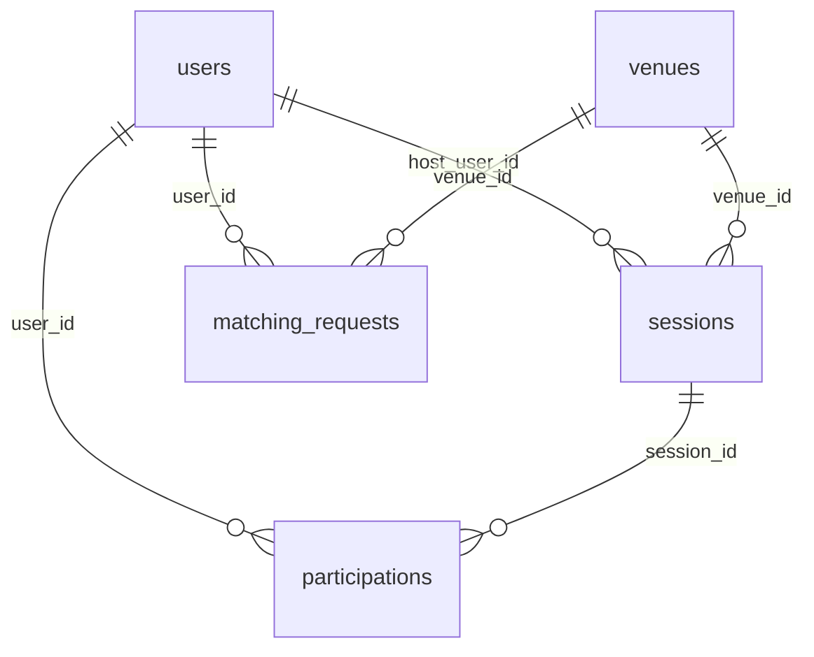

# Kiến trúc và dữ liệu

Python 3.11+, FastAPI, Pydantic, SQLAlchemy 2, SQLite. Đăng nhập bằng JWT HS256, mật khẩu băm Argon2.

## Cấu trúc code

```text
app/
├── main.py        ghép router, middleware, xử lý lỗi
├── config.py      đọc biến môi trường
├── composition.py nối UoW, reader, writer, repository và Strategy
├── api/           xử lý lỗi HTTP dùng chung
├── domain/        enum, entity, luật thời gian, Protocol (Python thuần)
├── db/            model SQLAlchemy, session, UnitOfWork
└── features/
    ├── auth/        đăng ký, đăng nhập, JWT middleware
    ├── catalog/
    │   ├── contracts.py
    │   └── venue_reader.py
    ├── matching/
    │   ├── routers/requests.py
    │   ├── schemas.py
    │   ├── contracts.py
    │   ├── service.py
    │   ├── strategy.py
    │   ├── repository.py
    │   └── matching_request_writer.py
    ├── discovery/
    │   ├── routers/venues.py
    │   ├── routers/sessions.py
    │   ├── schemas.py
    │   ├── contracts.py
    │   ├── service.py
    │   └── repository.py
    └── sessions/    kèo (session_*) và lượt tham gia (participation_*)
```

Ba tầng: router (API), service (nghiệp vụ), repository (truy cập dữ liệu). `schemas.py` chứa dữ liệu vào/ra HTTP; `contracts.py` chứa dữ liệu thuần và interface mà nghiệp vụ sử dụng. Chỉ tạo thành phần khi module cần: Catalog hiện cung cấp reader, chưa cần router riêng. Matching xử lý nhu cầu ghép nhóm; Discovery chỉ tìm sân và tìm kèo. `composition.py` nối implementation vào các interface.

`sessions` gom kèo và lượt tham gia vào một module vì tạo kèo, xin, duyệt và hủy dùng chung một transaction. Trong `sessions`, tên file có tiền tố, ví dụ `session_service.py` và `participation_service.py`.

Cây trên cập nhật phần member3 ngày 24/11/2026. Các đường dẫn cũ như `catalog/infrastructure/venue_reader.py`, `matching/domain/strategy.py`, `matching/infrastructure/*.py` và `discovery/router.py`, `matching/router.py` chỉ chuyển tiếp import sang implementation mới. Chúng giữ tương thích cho entry point và code/test của các thành viên khác, không chứa bản triển khai thứ hai. Chi tiết phạm vi ở [bàn giao member3, mục 16](Implementation/phase2-member3.md#16-refactor-cách-viết-và-thư-mục-member3-ngày-24112026).

## Luật phụ thuộc

- `app/domain/`, mọi `service.py`, `contracts.py` và `strategy.py` không import `fastapi`, `starlette`, `pydantic`, `sqlalchemy`, `sqlite3` hay `app.db`. `tests/test_architecture.py` kiểm luật này, kể cả Strategy đặt trực tiếp trong module.
- Repository dùng SQLAlchemy ORM và trả dữ liệu thuần cho service.
- Lỗi nghiệp vụ là `DomainError` kèm mã lỗi. `app/api/error_handlers.py` đổi mã đó sang HTTP status.
- JWT được kiểm một lần ở middleware. Endpoint không tự giải mã token. Quyền trên từng bản ghi (host, chủ lượt) do service kiểm.

## Transaction

`app/db/unit_of_work.py` quản lý transaction cho service:

- Thao tác ghi mở bằng `BEGIN IMMEDIATE`, đọc đồng hồ sau khi có khóa. Các bước kiểm tra và ghi dùng chung một connection, commit một lần. Lỗi thì rollback.
- Thao tác đọc mở bằng `BEGIN` để cả request nhìn cùng một snapshot.
- SQLite chỉ có một writer. Chờ khóa quá `SQLITE_BUSY_TIMEOUT_MS` (mặc định 5000) thì trả `503 DATABASE_BUSY`.

Đăng ký và tạo kèo mở transaction ghi ngay trong dependency, trước khi Pydantic kiểm body. Body sai vẫn không ghi gì, nhưng khi DB đang bận, client nhận 503 thay vì 422.

Hai lịch chồng nhau khi `start_a < end_b` và `start_b < end_a`, nên hai lịch nối tiếp không bị coi là chồng.

## Dữ liệu



Năm bảng: `users`, `venues`, `sessions`, `participations`, `matching_requests`. Cột đầy đủ ở `app/db/models.py`. Giờ lưu UTC dạng TEXT. Số chỗ của kèo không có cột riêng, được đếm từ các lượt `ACCEPTED`.

Ràng buộc do DB giữ:

- Khóa ngoại bật cho từng connection (`PRAGMA foreign_keys = ON`).
- `CHECK` cho enum, giờ bắt đầu trước giờ kết thúc, phí không âm.
- `uq_participations_active`: mỗi người chỉ có một lượt `PENDING` hoặc `ACCEPTED` trong một kèo. Lượt đã `REJECTED` hoặc `CANCELLED` vẫn được giữ.
- `uq_matching_requests_active_user`: mỗi người chỉ có một nhu cầu matching `ACTIVE`.

## Chưa làm trong Pha 1

Frontend hoàn chỉnh, chat và thông báo, đặt sân thật, thanh toán, xác minh trình độ, tìm theo GPS. Tra cứu theo quận (`district_code`).
