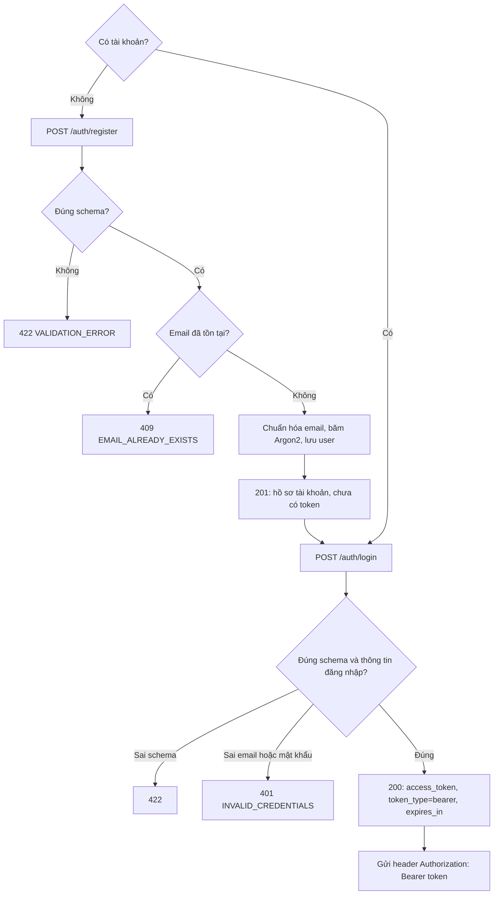
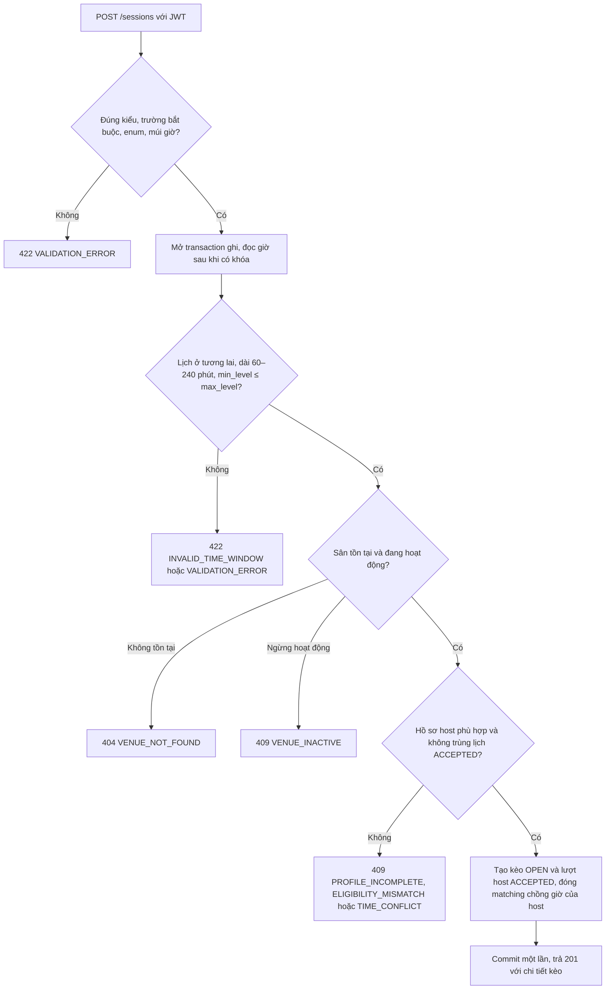
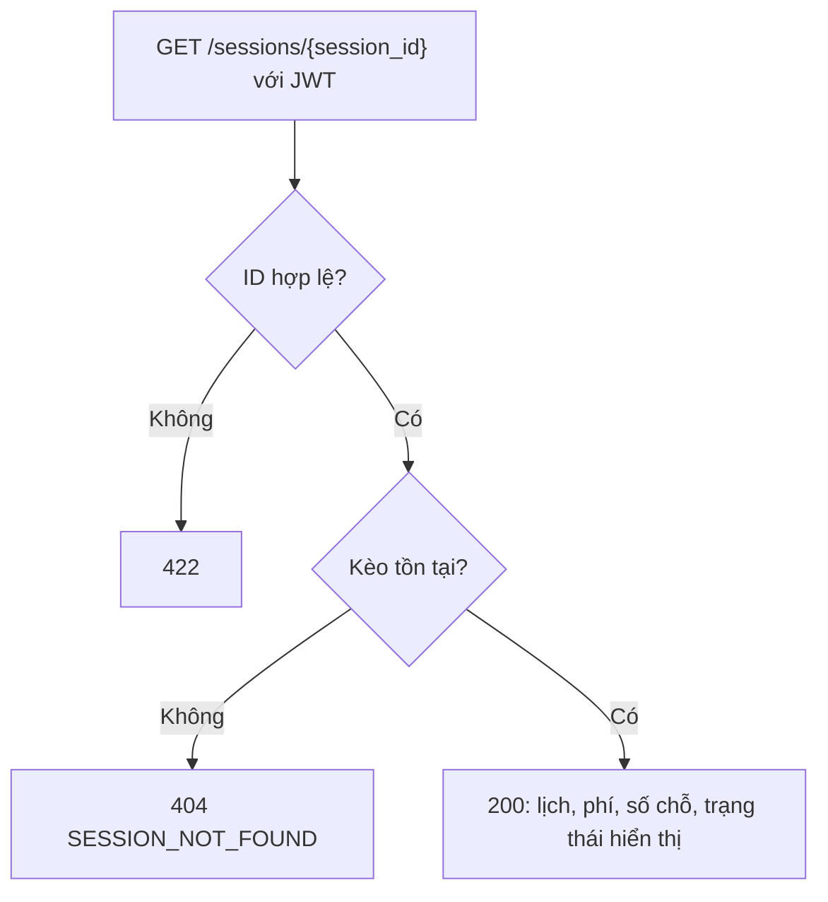
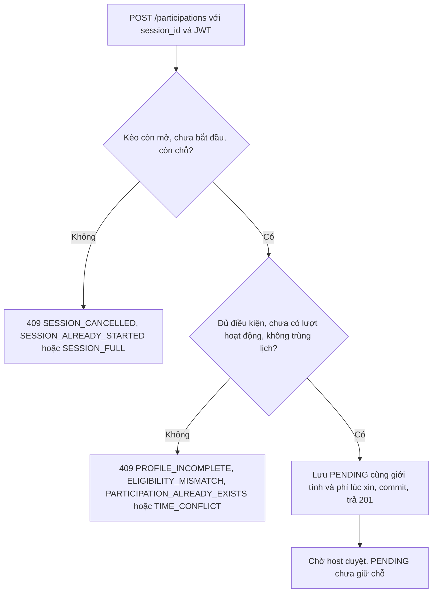
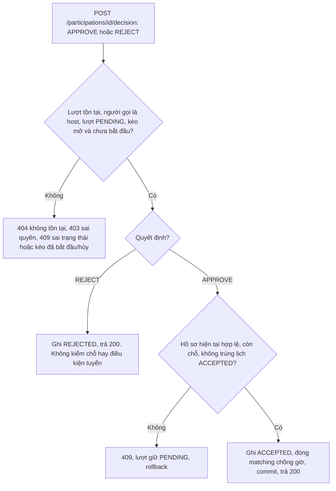

# Tuần 1: Tài khoản, tạo kèo, xin và duyệt

Mốc cuối tuần 1 theo đặc tả: Docker, `/health` và Swagger chạy; đăng nhập và các API có bảo vệ hoạt động; chuỗi tạo kèo → xin tham gia → host duyệt chạy được trên SQLite thật.

Tài liệu này mô tả năm luồng của tuần 1. Quy tắc chung và cấu trúc code ở [thiết kế](thiet-ke.md). Các luồng còn lại ở [tuần 2](../tuan-2-hoan-thien-api/luong-nghiep-vu.md).

Với API cần đăng nhập, JWT thiếu, sai hoặc hết hạn trả `401 UNAUTHORIZED`. Client đăng nhập lại rồi gửi lại yêu cầu. Hệ thống không tự sửa dữ liệu sai và không tạo dữ liệu thay người dùng.

| Mục | Luồng | FR |
|---|---|---|
| 1 | Đăng ký và đăng nhập | 01, 02 |
| 2 | Tạo kèo | 05 |
| 3 | Xem chi tiết kèo | 06 |
| 4 | Xin tham gia | 08 |
| 5 | Host duyệt hoặc từ chối | 09 |

## 1. Đăng ký và đăng nhập (FR-01, FR-02)

| Trường đăng ký | Ràng buộc |
|---|---|
| `email` | Email hợp lệ. Bỏ khoảng trắng hai đầu, chuyển chữ thường |
| `password` | 8–128 ký tự. Chỉ lưu bản băm |
| `display_name` | Sau khi cắt khoảng trắng còn 1–80 ký tự |
| `skill_level` | Một trong 19 mã của `SkillLevel` |
| `gender` | `MALE` hoặc `FEMALE` |

Thiếu trường, sai kiểu, enum sai hoặc thừa trường đều trả 422. Đăng nhập chỉ nhận `email` và `password`. Khi sai thông tin, phản hồi không cho biết email có tồn tại hay không.

Đăng ký chỉ tạo hồ sơ, token chỉ được cấp ở bước đăng nhập. Middleware kiểm token trước khi request vào API cần đăng nhập.

## 2. Tạo kèo (FR-05)

| Dữ liệu | Ràng buộc |
|---|---|
| `venue_id` | Số nguyên dương, sân tồn tại và đang hoạt động |
| `title`, `notes` | Tiêu đề 1–120 ký tự sau khi cắt khoảng trắng. Ghi chú không bắt buộc, tối đa 1000 ký tự |
| `starts_at`, `ends_at` | ISO 8601 có múi giờ. Bắt đầu ở tương lai, thời lượng 60–240 phút |
| `play_type` | `SINGLES` là 2 người, `DOUBLES` là 4 người, đều tính host |
| `fee_male_vnd`, `fee_female_vnd` | Số nguyên VND không âm |
| `min_level`, `max_level` | Mã trình hợp lệ, min không cao hơn max, host phải nằm trong khoảng |
| `gender_policy` | `ANY` (mặc định), `MALE_ONLY` hoặc `FEMALE_ONLY`. Host cũng phải phù hợp |

ID và phí không vượt giới hạn INTEGER 64 bit của SQLite. Host lấy từ JWT. Sức chứa và trạng thái do hệ thống đặt, client không gửi.

Kèo và lượt của host được ghi trên cùng connection. Nếu lỗi giữa chừng, transaction rollback nên không có kèo nào thiếu lượt host. Lỗi 409 nghĩa là chưa tạo kèo.

## 3. Xem chi tiết kèo (FR-06)

Chi tiết trả số chỗ (đếm từ lượt `ACCEPTED`), lượt của người đang xem và hai cờ `can_cancel`, `can_decide`. Host còn nhận danh sách lượt để quản lý.

Trạng thái `AVAILABLE`, `FULL`, `STARTED`, `ENDED`, `CANCELLED` là trạng thái hiển thị tính từ lịch và số người (bảng ở [thiết kế](thiet-ke.md)), không phải cột trong DB. Hai cờ quyền chỉ để giao diện hiển thị. Service kiểm quyền lại khi nhận thao tác ghi.

## 4. Xin tham gia (FR-08)

Số chỗ người dùng thấy ở trang xem chi tiết chỉ để tham khảo. Khi xin tham gia, hệ thống kiểm lại từ đầu trong transaction. Xin tham gia chỉ tạo lượt `PENDING`, chưa giữ chỗ.

Giới tính và phí được lưu ngay lúc xin (`gender_at_join`, `quoted_fee_vnd`). Các bước sau không tính lại hai giá trị này.

## 5. Host duyệt hoặc từ chối (FR-09)

Body sai (thiếu, sai hoặc thừa trường) và ID sai định dạng trả 422.

- Duyệt không chỉ đổi trạng thái. Nó xác nhận một lịch chơi, nên phải đóng các nhu cầu matching chồng giờ trong cùng transaction.
- `REJECT` không chiếm chỗ, nên không cần kiểm sức chứa.
- Khi duyệt, hồ sơ người chơi được kiểm lại theo dữ liệu hiện tại, còn phí và giới tính vẫn là bản đã lưu lúc xin.
- Hai yêu cầu duyệt cùng nhắm vào chỗ cuối không thể cùng thành công. Yêu cầu lấy được khóa sau phải đếm lại các lượt `ACCEPTED`.
