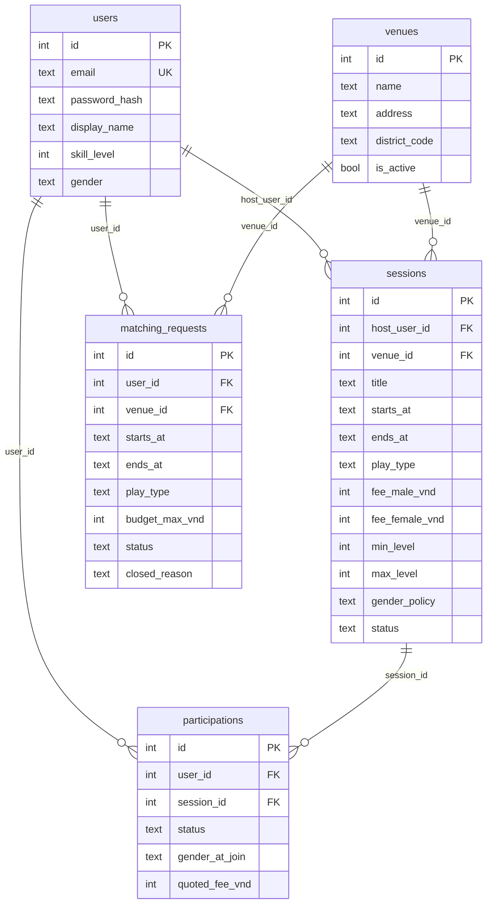

# Tuần 1: Nền tảng và thiết kế

Tài liệu này chốt những thứ không đổi trong suốt Pha 1: cách chia lớp code, dữ liệu trong DB và danh sách API. Đây là phần nền của tuần 1: ứng dụng, DB, UnitOfWork, JWT và Docker phải chạy trước khi làm nghiệp vụ.

## Phạm vi

MatchMate là backend REST API cho người chơi cầu lông. Người chơi tìm sân và kèo theo quận, tạo kèo, xin vào kèo, và gửi nhu cầu để được gợi ý nhóm.

Pha 1 chưa có: frontend hoàn chỉnh, chat hay thông báo, đặt sân thật, thanh toán hoàn tiền, xác minh trình độ, Elo/AI, danh sách chờ. GPS đã bị nhóm bỏ khỏi Pha 1; tra cứu theo quận (`district_code`).

## Công nghệ

Python 3.11+, FastAPI, Pydantic, SQLAlchemy 2, SQLite. Đăng nhập bằng JWT HS256, mật khẩu băm Argon2.

## Cấu trúc code

```text
app/
├── main.py            ghép router, middleware, xử lý lỗi
├── config.py          đọc biến môi trường
├── api/               xử lý lỗi HTTP dùng chung
├── domain/            enum, entity, luật thời gian, Protocol (Python thuần)
├── db/                model SQLAlchemy, session, UnitOfWork
└── features/
    ├── auth/          đăng ký, đăng nhập, JWT middleware
    ├── discovery/     tìm sân, tìm kèo, matching
    └── sessions/      kèo (session_*) và lượt tham gia (participation_*)
```

Pha 1 giữ ba module này. Hai nhóm file `session_*` và `participation_*` nằm chung trong `sessions/` vì tạo kèo, xin, duyệt và hủy dùng chung một transaction.

Mỗi module có cùng các loại file: router, `schemas` (dữ liệu vào/ra HTTP), `service` (nghiệp vụ), `contracts` (kiểu dữ liệu và `Protocol` mà service dùng), `repository` (truy cập DB) và `dependencies` (lắp ghép các thành phần). Trong `auth` và `discovery` tên file là `router.py`, `service.py`... Trong `sessions` có tiền tố, ví dụ `session_service.py` và `participation_service.py`. Phần lắp ghép của kèo nằm trong `session_router.py`. `auth` có thêm middleware, băm mật khẩu và phát token.

Một request đi theo đường: router → service → repository → DB. Service chỉ biết `Protocol` trong `contracts.py`, không biết SQLAlchemy.

### Luật phụ thuộc

- `app/domain/`, mọi `service.py` và mọi `contracts.py` không import `fastapi`, `starlette`, `pydantic`, `sqlalchemy`, `sqlite3` hay `app.db`. `tests/test_architecture.py` kiểm luật này.
- Repository mới được dùng SQLAlchemy Session và model.
- Lỗi nghiệp vụ là `DomainError` kèm mã lỗi. `app/api/error_handlers.py` đổi mã đó sang HTTP status.

### Transaction

`app/db/unit_of_work.py` quản lý transaction cho service:

- Thao tác ghi mở bằng `BEGIN IMMEDIATE` và đọc Clock sau khi đã có khóa. Các bước kiểm tra và ghi dùng chung một connection, commit một lần. Lỗi hoặc thoát khi chưa commit thì rollback.
- Thao tác đọc mở bằng `BEGIN` để cả request nhìn cùng một snapshot.
- SQLite chỉ có một writer. Nếu chờ khóa quá `SQLITE_BUSY_TIMEOUT_MS` (mặc định 5000), API trả `503 DATABASE_BUSY` kèm `Retry-After: 1`.

### Thời gian

Dữ liệu vào phải có múi giờ, hệ thống chuẩn hóa sang UTC. DB lưu UTC dạng TEXT cố định, API trả thời gian có hậu tố `Z`. Hai lịch chồng nhau khi `start_a < end_b` và `start_b < end_a`, nên hai lịch nối tiếp không bị coi là chồng.

## Dữ liệu



Sơ đồ chỉ ghi các cột chính. Đầy đủ cột nằm ở `app/db/models.py`.

Ràng buộc do chính DB giữ:

- Khóa ngoại bật cho từng connection (`PRAGMA foreign_keys = ON`).
- `CHECK` cho enum, thời gian bắt đầu trước kết thúc và phí không âm.
- `uq_participations_active`: mỗi người chỉ có một lượt `PENDING` hoặc `ACCEPTED` trong một kèo. Lượt cũ đã `REJECTED` hoặc `CANCELLED` vẫn được giữ làm lịch sử.
- `uq_matching_requests_active_user`: mỗi người chỉ có một nhu cầu matching `ACTIVE`.

Số chỗ của kèo không lưu thành cột. Nó được đếm từ các lượt `ACCEPTED`.

## Quy tắc nghiệp vụ

- Kèo đơn có 2 người, kèo đôi có 4 người, tính cả host.
- Lịch ở tương lai, dài 60–240 phút.
- Tạo kèo ghi luôn lượt của host với trạng thái `ACCEPTED`.
- Xin tham gia tạo lượt `PENDING`. Lượt này chưa giữ chỗ.
- Duyệt lượt kiểm lại quyền host, trạng thái kèo và lượt, điều kiện tuyển, sức chứa và lịch `ACCEPTED` của người chơi.
- Phí và giới tính của người chơi được lưu lúc xin tham gia (`quoted_fee_vnd`, `gender_at_join`). Duyệt, rút và hủy dùng lại hai giá trị này.
- Người chơi rút lượt trước giờ bắt đầu. Host không rút lượt mà phải hủy cả kèo.
- Hủy kèo đổi mọi lượt `PENDING` và `ACCEPTED`, kể cả của host, sang `CANCELLED` trong cùng transaction.
- Matching chỉ gợi ý nhóm đủ 2 hoặc 4 người, cùng sân, cùng giờ và cùng loại kèo. Gợi ý không tạo kèo và không giữ chỗ. Khi một lịch được xác nhận (tạo kèo hoặc duyệt lượt), các nhu cầu matching chồng giờ của người đó bị đóng trong cùng transaction.

Các cờ quyền trong response (`can_cancel`, `can_decide`) chỉ để giao diện hiển thị. Service luôn kiểm quyền lại khi nhận thao tác ghi.

### Trạng thái hiển thị của kèo

DB chỉ lưu `OPEN` hoặc `CANCELLED`. Khi trả về, hệ thống tính thêm trạng thái hiển thị theo thứ tự sau (hàm `compute_display_status`):

| Điều kiện | Trạng thái |
|---|---|
| Kèo đã hủy | `CANCELLED` |
| Đã qua giờ kết thúc | `ENDED` |
| Đã qua giờ bắt đầu | `STARTED` |
| Số lượt `ACCEPTED` bằng sức chứa | `FULL` |
| Còn lại | `AVAILABLE` |

## API

Đặc tả đầy đủ nằm ở [openapi.json](../openapi.json). Khi chạy ứng dụng, mở `/docs` để thử API hoặc `/redoc` để đọc.

| FR | Method và đường dẫn | Chức năng | Quyền | Tuần |
|---|---|---|---|---|
| 01 | `POST /auth/register` | Đăng ký | Công khai | 1 |
| 02 | `POST /auth/login` | Đăng nhập | Công khai | 1 |
| 03 | `GET /venues` | Tìm sân | Công khai | 2 |
| 04 | `GET /sessions` | Tìm kèo (`host_me=true` cần JWT) | Công khai | 2 |
| 05 | `POST /sessions` | Tạo kèo | JWT | 1 |
| 06 | `GET /sessions/{session_id}` | Xem chi tiết kèo | JWT | 1 |
| 07 | `DELETE /sessions/{session_id}` | Hủy kèo | Chỉ host | 2 |
| 08 | `POST /participations` | Xin tham gia | JWT | 1 |
| 09 | `POST /participations/{participation_id}/decision` | Duyệt hoặc từ chối | Chỉ host | 1 |
| 10 | `DELETE /participations/{participation_id}` | Rút lượt của mình | Chủ lượt | 2 |
| 11 | `POST /matching/requests` | Gợi ý ghép nhóm | JWT | 2 |

`GET /health` chỉ cho biết tiến trình đang chạy, không kiểm tra DB.

Mọi lỗi dùng chung một dạng: `{"error": {"code", "message", "details", "request_id"}}`. Lỗi không chứa mật khẩu, token hay câu SQL.

## Khi thay DB hoặc thêm frontend

Giữ nguyên các ràng buộc DB ở trên, kiểm quyền host trong service và việc gom các bước liên quan vào một transaction.
