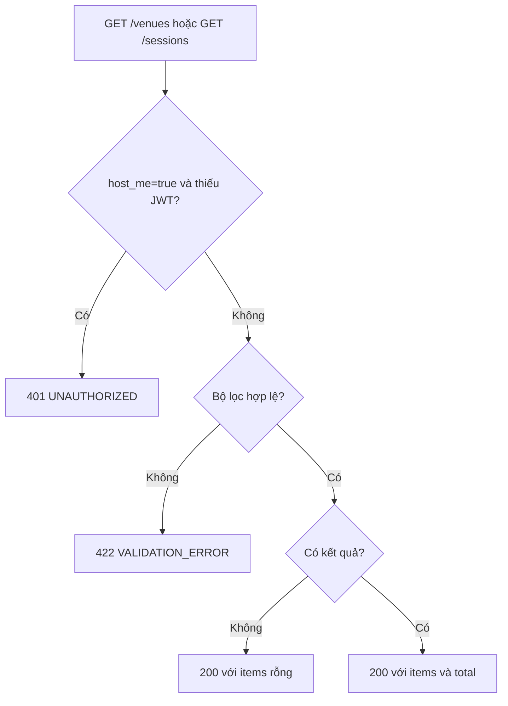
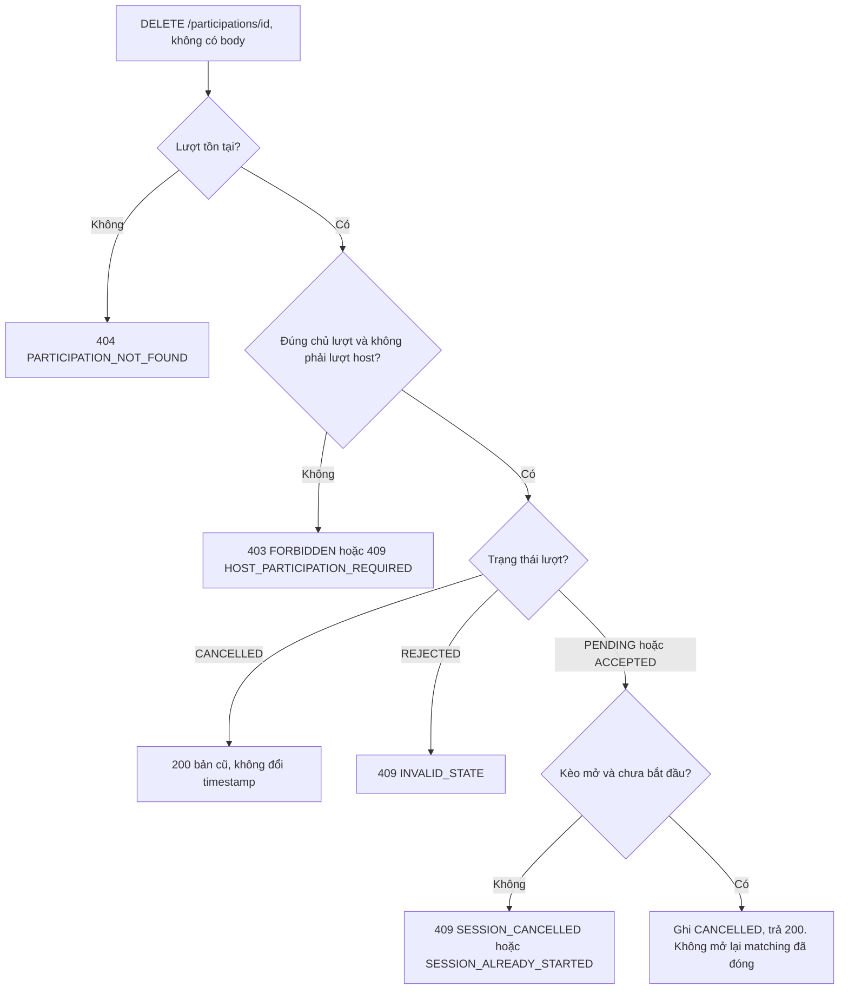
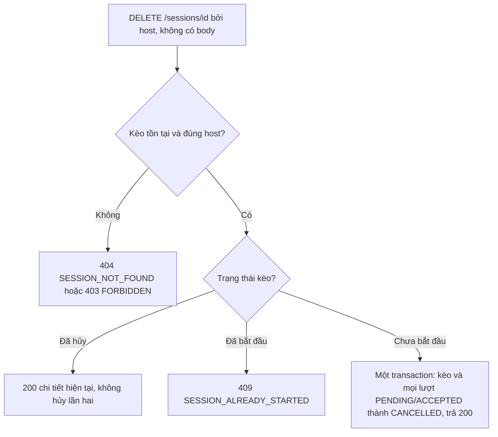
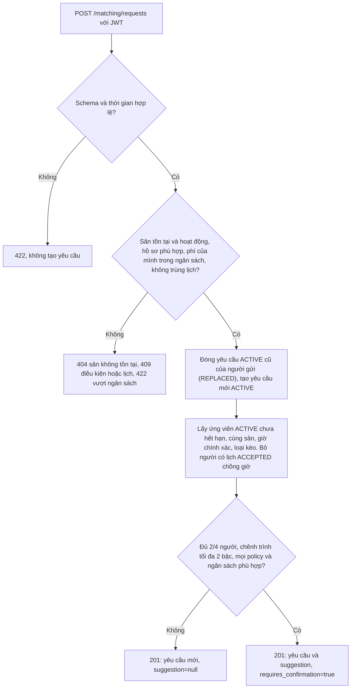

# Tuần 2: Tìm kiếm, rút lượt, hủy kèo và matching

Mốc cuối tuần 2 theo đặc tả: đủ 11 API theo contract; toàn luồng và matching hoạt động; test các quy tắc nghiệp vụ chính đạt.

Tuần 2 thêm bốn luồng vào năm luồng của [tuần 1](../tuan-1-nen-tang/luong-nghiep-vu.md). Danh sách 11 API và quy tắc chung ở [thiết kế](../tuan-1-nen-tang/thiet-ke.md).

| Mục | Luồng | FR |
|---|---|---|
| 1 | Tìm sân và tìm kèo | 03, 04 |
| 2 | Người chơi rút lượt | 10 |
| 3 | Host hủy kèo | 07 |
| 4 | Gợi ý ghép nhóm | 11 |

## 1. Tìm sân và tìm kèo (FR-03, FR-04)

Hai API này công khai, trừ `host_me=true`. Chúng không ghi dữ liệu. JWT được kiểm trước bộ lọc, nên `host_me=true` thiếu token trả 401 dù bộ lọc cũng sai.

**`GET /venues`** lọc theo `district_code` và phân trang (`limit`, `offset`).

**`GET /sessions`** lọc theo `district_code`, `venue_id`, `play_type`, `skill_level`, `gender`, `max_fee_vnd`, `available_from`, `available_to`, `only_available`, `host_me`, `limit`, `offset`.

- `available_from` và `available_to` phải cùng có hoặc cùng vắng, mốc đầu nhỏ hơn mốc cuối, cả hai có múi giờ.
- Phí không âm. `limit` từ 1 đến 100, `offset` không âm.
- `host_me=true` cần JWT và chỉ trả kèo của tài khoản đang đăng nhập.
- Tham số ngoài contract trả 422.

Kết quả luôn là một trang `items` kèm `total`. Không có kết quả là trường hợp bình thường (`items` rỗng), không phải lỗi.

**Không có GPS:** nhóm đã quyết bỏ lọc theo tọa độ (`latitude`, `longitude`, `radius_km`, `distance_km`) khỏi Pha 1. Tra cứu chỉ theo quận (`district_code`). Đặc tả cũ vẫn còn mô tả phần này.

## 2. Người chơi rút lượt (FR-10)

- Rút xong, chỗ được trả lại cho kèo (số chỗ đếm từ lượt `ACCEPTED`).
- Gọi `DELETE` lặp lại trên lượt đã `CANCELLED` vẫn trả 200 và dữ liệu hiện tại. Hệ thống kiểm tồn tại và quyền trước, rồi mới kiểm giờ.
- Host không rút lượt. Host phải hủy cả kèo (mục 3).
- Xin lại sau khi rút tạo lượt mới. Lượt cũ giữ nguyên làm lịch sử.

## 3. Host hủy kèo (FR-07)

Hủy là hủy mềm: kèo và lượt chuyển sang `CANCELLED`, bản ghi vẫn còn. Lượt của host cũng bị hủy trong cùng transaction. Nếu duyệt và hủy kèo chạy gần nhau, kết quả theo thứ tự commit: hủy trước thì duyệt bị từ chối, duyệt trước thì lượt vừa `ACCEPTED` cũng bị hủy theo.

## 4. Gợi ý ghép nhóm (FR-11)

Trường gửi lên: `venue_id`, `starts_at`, `ends_at`, `play_type`, `proposed_fee_male_vnd`, `proposed_fee_female_vnd`, `budget_max_vnd`, `gender_policy` (mặc định `ANY`). ID, phí, thời lượng và múi giờ theo cùng giới hạn như tạo kèo.

Cách chọn nhóm:

- Ứng viên phải cùng sân, cùng giờ chính xác và cùng loại kèo. Thứ tự xét là `created_at` rồi `id` tăng dần.
- Kèo đơn cần 1 ứng viên (đủ 2 người với người gọi). Kèo đôi xét tổ hợp 3 ứng viên (đủ 4 người).
- Nhóm đầu tiên thỏa mọi điều kiện sẽ được chọn: chênh trình `max(rank) - min(rank)` không quá 2, policy giới tính của mọi người phù hợp, ngân sách từng người đủ.
- Phí của nhóm lấy theo hai mức người gọi đề xuất: thành viên nam theo phí nam, thành viên nữ theo phí nữ. Mỗi mức phải nằm trong ngân sách của đúng người đó.

Matching chỉ gợi ý. Nó không tạo kèo hay lượt tham gia nào. Không đủ người là kết quả bình thường (`suggestion=null`), không phải lỗi.

Mỗi người chỉ giữ một yêu cầu `ACTIVE`: gọi lại API tạo yêu cầu mới và thay yêu cầu cũ, nên API này không idempotent. Yêu cầu cũng bị đóng khi người đó xác nhận một lịch chồng giờ, lúc tạo kèo hoặc khi được duyệt.
