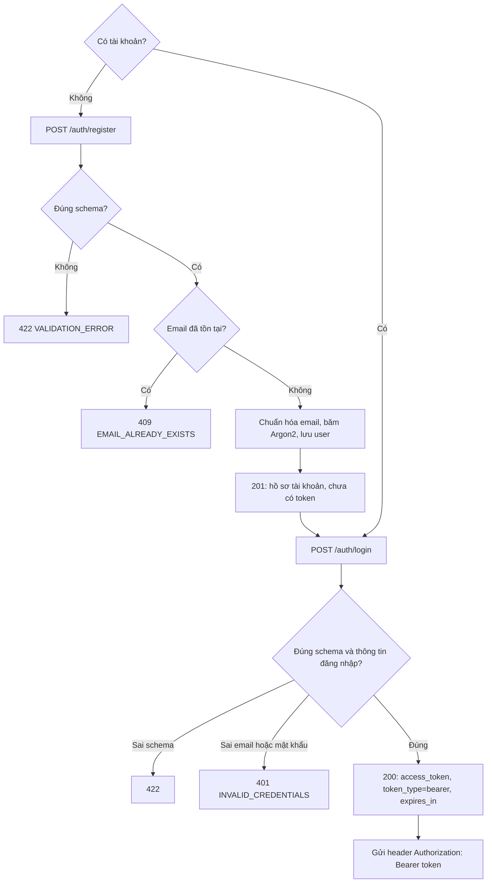
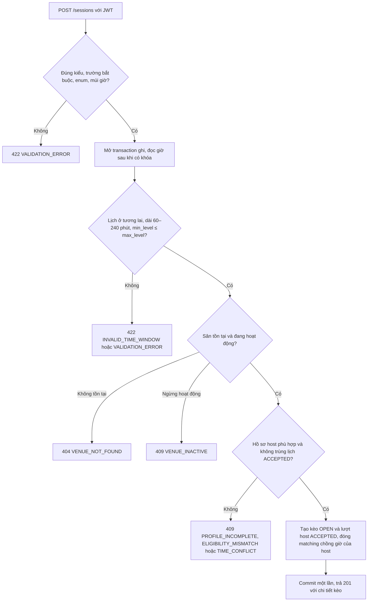
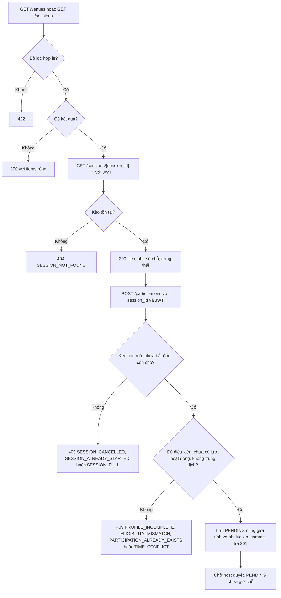
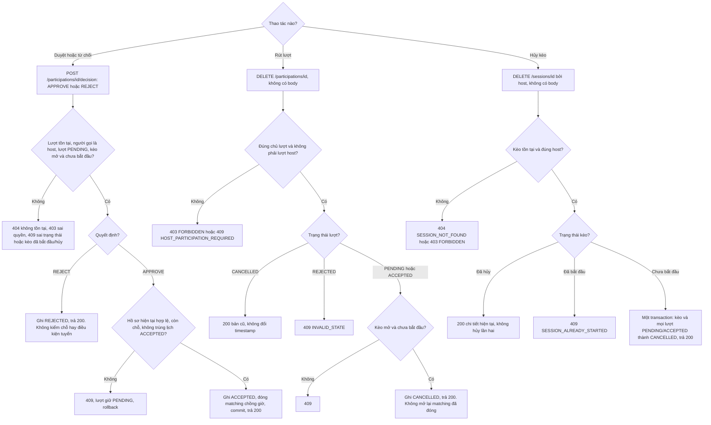
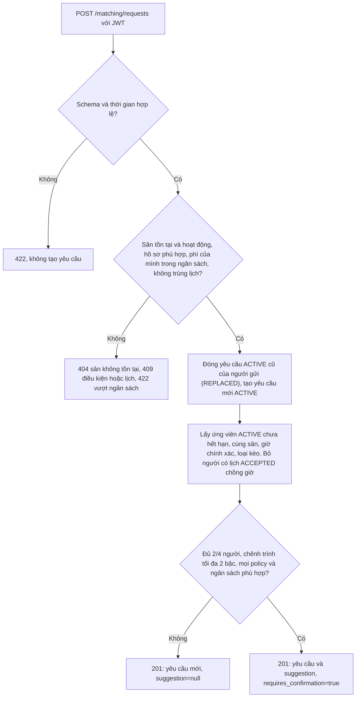
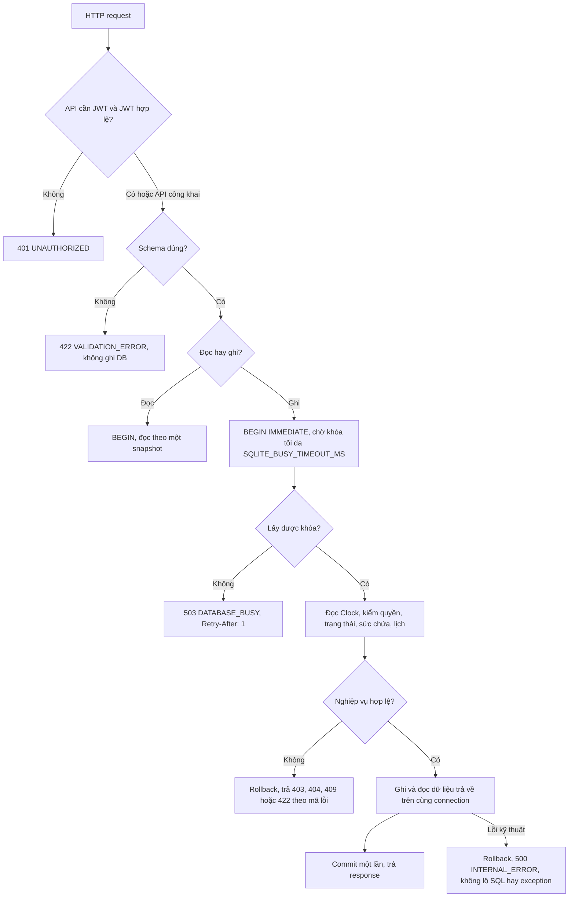

# Tuần 2: Luồng nghiệp vụ

Tài liệu mô tả từng luồng đã làm, với dữ liệu nhập, các lỗi có thể gặp và kết quả. Quy tắc chung và danh sách API ở [thiết kế tuần 1](../tuan-1-thiet-ke/thiet-ke.md).

Với API cần đăng nhập, JWT thiếu, sai hoặc hết hạn trả `401 UNAUTHORIZED`. Client đăng nhập lại rồi gửi lại yêu cầu. Hệ thống không tự sửa dữ liệu sai và không tạo dữ liệu thay người dùng.

| Mục | Luồng | FR |
|---|---|---|
| 1 | Đăng ký và đăng nhập | 01, 02 |
| 2 | Tạo kèo | 05 |
| 3 | Tìm kèo, xem chi tiết, xin tham gia | 03, 04, 06, 08 |
| 4 | Duyệt, rút lượt, hủy kèo | 07, 09, 10 |
| 5 | Gợi ý ghép nhóm | 11 |
| 6 | Từ HTTP đến DB | mọi API |

## 1. Đăng ký và đăng nhập (FR-01, FR-02)

| Trường đăng ký | Ràng buộc |
|---|---|
| `email` | Email hợp lệ. Bỏ khoảng trắng hai đầu, chuyển chữ thường |
| `password` | 8–128 ký tự. Chỉ lưu bản băm |
| `display_name` | Sau khi cắt khoảng trắng còn 1–80 ký tự |
| `skill_level` | Một trong 19 mã của `SkillLevel` |
| `gender` | `MALE` hoặc `FEMALE` |

Thiếu trường, sai kiểu, enum sai hoặc thừa trường đều trả 422. Đăng nhập chỉ nhận `email` và `password`. Khi sai thông tin, phản hồi không cho biết email có tồn tại hay không.

Đăng ký chỉ tạo hồ sơ, token chỉ được cấp ở bước đăng nhập. Middleware kiểm token trước khi request vào API cần đăng nhập.

## 2. Tạo kèo (FR-05)

| Dữ liệu | Ràng buộc |
|---|---|
| `venue_id` | Số nguyên dương, sân tồn tại và đang hoạt động |
| `title`, `notes` | Tiêu đề 1–120 ký tự sau khi cắt khoảng trắng. Ghi chú không bắt buộc, tối đa 1000 ký tự |
| `starts_at`, `ends_at` | ISO 8601 có múi giờ. Bắt đầu ở tương lai, thời lượng 60–240 phút |
| `play_type` | `SINGLES` là 2 người, `DOUBLES` là 4 người, đều tính host |
| `fee_male_vnd`, `fee_female_vnd` | Số nguyên VND không âm |
| `min_level`, `max_level` | Mã trình hợp lệ, min không cao hơn max, host phải nằm trong khoảng |
| `gender_policy` | `ANY` (mặc định), `MALE_ONLY` hoặc `FEMALE_ONLY`. Host cũng phải phù hợp |

ID và phí không vượt giới hạn INTEGER 64 bit của SQLite. Host lấy từ JWT. Sức chứa và trạng thái do hệ thống đặt, client không gửi.

Kèo và lượt của host được ghi trên cùng connection. Nếu lỗi giữa chừng, transaction rollback nên không có kèo nào thiếu lượt host. Lỗi 409 nghĩa là chưa tạo kèo.

## 3. Tìm kèo, xem chi tiết, xin tham gia (FR-03, 04, 06, 08)

**Bộ lọc của `GET /sessions`:** `district_code`, `venue_id`, `play_type`, `skill_level`, `gender`, `max_fee_vnd`, `available_from`, `available_to`, `only_available`, `host_me`, `limit`, `offset`.

- `available_from` và `available_to` phải cùng có hoặc cùng vắng, mốc đầu nhỏ hơn mốc cuối, cả hai có múi giờ.
- Phí không âm. `limit` từ 1 đến 100, `offset` không âm.
- `host_me=true` cần JWT và chỉ trả kèo của tài khoản đang đăng nhập.
- `GET /venues` chỉ lọc theo quận và phân trang.

**Chi tiết kèo** trả số chỗ (đếm từ lượt `ACCEPTED`), lượt của người đang xem và hai cờ `can_cancel`, `can_decide`. Host còn nhận danh sách lượt để quản lý. Trạng thái `AVAILABLE`, `FULL`, `STARTED`, `ENDED`, `CANCELLED` là trạng thái hiển thị tính từ lịch và số người (bảng ở tuần 1), không phải cột trong DB.

Số chỗ người dùng thấy ở trang trước chỉ để tham khảo. Khi xin tham gia và khi duyệt, hệ thống kiểm lại từ đầu trong transaction.

## 4. Duyệt, rút lượt, hủy kèo (FR-07, 09, 10)

ID sai định dạng, hoặc body quyết định thiếu, sai, thừa trường, trả 422. Mỗi nhánh thành công trả chi tiết hiện tại, và chỉ trả sau khi commit.

Vài điểm cần nhớ:

- Duyệt không chỉ đổi trạng thái. Nó xác nhận một lịch chơi, nên phải đóng các nhu cầu matching chồng giờ trong cùng transaction.
- `REJECT` không chiếm chỗ, nên không cần kiểm sức chứa.
- Rút lượt và hủy kèo gọi lặp vẫn an toàn.
- Xin lại sau khi rút hoặc bị từ chối tạo lượt mới. Lượt cũ giữ nguyên làm lịch sử.

## 5. Gợi ý ghép nhóm (FR-11)

Trường gửi lên: `venue_id`, `starts_at`, `ends_at`, `play_type`, `proposed_fee_male_vnd`, `proposed_fee_female_vnd`, `budget_max_vnd`, `gender_policy` (mặc định `ANY`). ID, phí, thời lượng và múi giờ theo cùng giới hạn như tạo kèo.

Mức phí của nhóm gợi ý lấy theo đề xuất của người gọi, và phải nằm trong ngân sách của từng thành viên.

Matching chỉ gợi ý. Nó không tạo kèo hay lượt tham gia nào. Không đủ người là kết quả bình thường (`suggestion=null`), không phải lỗi. Mỗi người chỉ giữ một yêu cầu `ACTIVE`: yêu cầu mới thay yêu cầu cũ. Yêu cầu cũng bị đóng khi người đó xác nhận một lịch chồng giờ ở luồng 2 hoặc luồng 4.

## 6. Từ HTTP đến DB

JWT middleware chạy trước router. Nếu một request vừa sai JWT vừa sai schema thì 401 đến trước. Với các lỗi nghiệp vụ, mã lỗi trả về phụ thuộc thứ tự các bước kiểm trong service.

Hai yêu cầu duyệt cùng nhắm vào chỗ cuối không thể cùng thành công. Yêu cầu lấy được khóa sau phải đếm lại các lượt `ACCEPTED`. Nếu chờ khóa quá hạn, client nhận 503 và tự thử lại.
