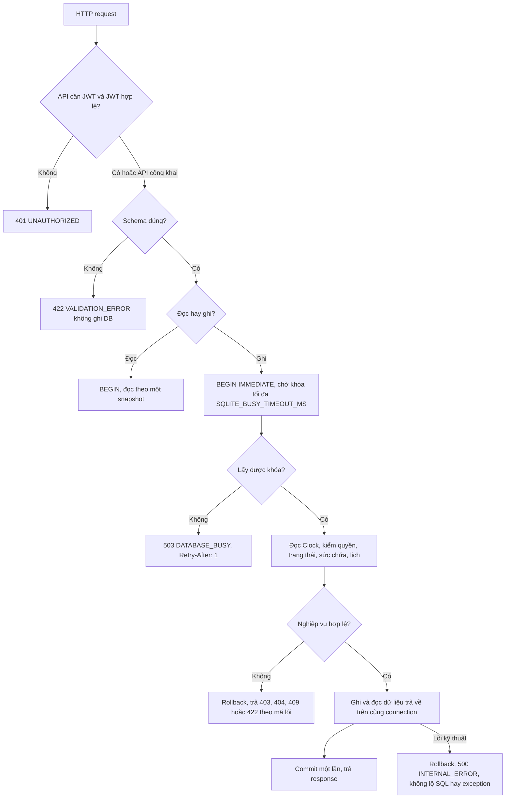

# Tuần 3: Từ HTTP đến DB

Tuần 3 theo đặc tả là test toàn luồng và test đồng thời. Tài liệu này mô tả đường đi chung của mọi request, từ đó suy ra những chỗ các test đó phải kiểm.



JWT middleware chạy trước router. Nếu một request vừa sai JWT vừa sai schema thì 401 đến trước.

Có một ngoại lệ với sơ đồ trên: đăng ký và tạo kèo mở transaction ghi ngay trong dependency, trước khi Pydantic kiểm body. Body sai vẫn không ghi gì, nhưng khi DB đang bận thì client nhận 503 thay vì 422. Với các lỗi nghiệp vụ, mã lỗi trả về phụ thuộc thứ tự các bước kiểm trong service.

## Giải quyết tranh chấp

Hai yêu cầu duyệt cùng nhắm vào chỗ cuối không thể cùng thành công. Yêu cầu lấy được khóa sau phải đếm lại các lượt `ACCEPTED`. Nếu chờ khóa quá hạn, client nhận 503 và tự quyết định có thử lại hay không. Hệ thống không tự chạy lại transaction.

Khi duyệt, rút và hủy chạy gần nhau, kết quả theo thứ tự commit:

| Thứ tự | Kết quả |
|---|---|
| Host hủy kèo trước, duyệt sau | Duyệt bị từ chối vì kèo đã hủy |
| Duyệt trước, hủy kèo sau | Lượt vừa `ACCEPTED` cũng bị hủy theo |
| Người chơi rút trước, duyệt sau | Duyệt bị từ chối vì lượt không còn `PENDING` |
| Duyệt trước, rút sau | Rút giải phóng đúng một chỗ |

## Test đồng thời

`tests/sessions/test_concurrency.py` chạy các cặp thao tác cạnh tranh trên DB tạm với nhiều connection thật, rồi kiểm lại bằng truy vấn vào DB:

- Hai lượt duyệt tranh chỗ cuối: chỉ một lượt thành công, không có kèo vượt sức chứa.
- Duyệt gặp rút, và duyệt gặp hủy kèo: kết quả khớp bảng trên.
- Cùng một người không được duyệt vào hai kèo chồng giờ.
- Clock được đọc sau khi lấy khóa ghi, không đọc trước lúc chờ.
- Hết thời gian chờ khóa thì không chạy bước nghiệp vụ nào.

Báo cáo tải kiểm thêm bốn chỉ số trên DB sau mỗi lượt đo, xem [báo cáo tải](bao-cao-tai.md).

## Lỗi

Mọi lỗi dùng chung một dạng:

```json
{"error": {"code": "SESSION_FULL", "message": "...", "details": {}, "request_id": "..."}}
```

`request_id` là mã truy vết của request HTTP, không phải ID của nhu cầu matching. Lỗi không chứa mật khẩu, token hay câu SQL. Mã `request_id` cũng nằm trong header `X-Request-ID`.
